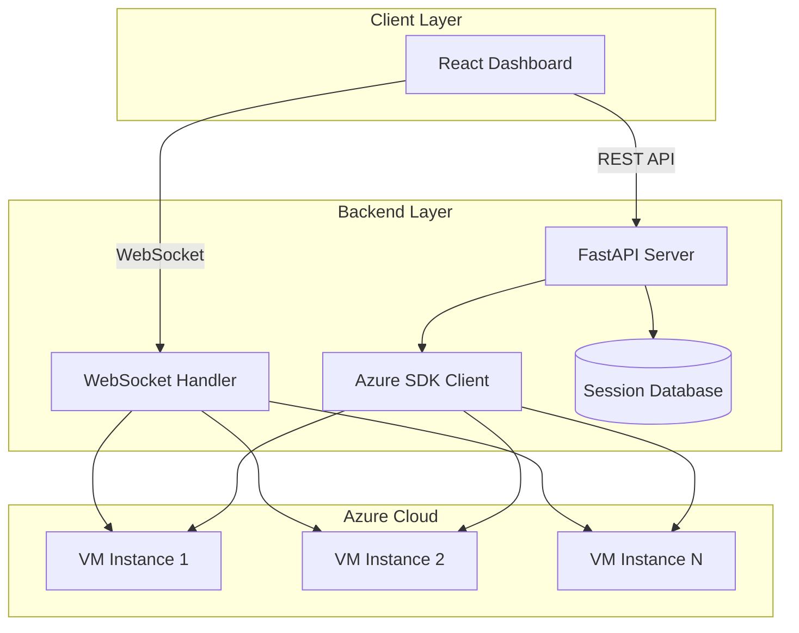

# Design Document: CTF Challenge Automation Platform

## Overview

The CTF Challenge Automation Platform is a web-based system that automates the creation and management of Azure VMs for solving CTF challenges using AI agents. The platform consists of a Python FastAPI backend that manages Azure resources and provides REST/WebSocket APIs, and a React frontend that provides an intuitive dashboard for VM creation, session management, and real-time terminal interaction.

The system architecture follows a client-server model where the React frontend communicates with the FastAPI backend via REST APIs for resource management and WebSocket connections for real-time terminal interaction. The backend uses the Azure SDK for Python to provision and manage VMs, and maintains persistent storage for session metadata.

## Architecture

### High-Level Architecture



### Component Architecture

The system is divided into three main layers:

1. **Frontend Layer (React)**
   - Dashboard component for session listing
   - VM creation form component
   - Session detail component with terminal
   - File viewer components for AGENT.md and TOOLS.md

2. **Backend Layer (Python FastAPI)**
   - REST API endpoints for CRUD operations
   - WebSocket endpoints for terminal connections
   - Azure VM management service
   - Session persistence service
   - SSH key management service

3. **Infrastructure Layer (Azure)**
   - Virtual machines with configurable resources
   - Network security groups for SSH access
   - Storage for VM disks

## Components and Interfaces

### Frontend Components

#### 1. Dashboard Component
**Purpose**: Display list of all sessions and provide navigation

**State**:
- `sessions`: Array of session objects
- `loading`: Boolean for loading state
- `error`: String for error messages

**Interface**:
```typescript
interface Session {
  id: string;
  vmSize: 'small' | 'medium' | 'large';
  agentType: 'codex' | 'copilot';
  agentModel: string;
  createdAt: string;
  status: 'creating' | 'running' | 'stopped' | 'error';
  challengeFiles: string[];
}

interface DashboardProps {
  onSessionSelect: (sessionId: string) => void;
  onCreateNew: () => void;
}
```

#### 2. VM Creation Form Component
**Purpose**: Collect VM configuration and submit creation request

**State**:
- `challengeUrls`: Array of strings
- `instructions`: String
- `agentType`: 'codex' | 'copilot'
- `agentModel`: String
- `vmSize`: 'small' | 'medium' | 'large'
- `submitting`: Boolean
- `errors`: Object with field-level errors

**Interface**:
```typescript
interface VMCreationRequest {
  challengeUrls: string[];
  instructions: string;
  agentType: 'codex' | 'copilot';
  agentModel: string;
  vmSize: 'small' | 'medium' | 'large';
}

interface VMCreationFormProps {
  onSuccess: (sessionId: string) => void;
  onCancel: () => void;
}
```

#### 3. Session Detail Component
**Purpose**: Display session information and provide terminal interaction

**State**:
- `session`: Session object
- `terminalConnected`: Boolean
- `agentMdContent`: String
- `toolsMdContent`: String
- `editingAgentMd`: Boolean

**Interface**:
```typescript
interface SessionDetailProps {
  sessionId: string;
}

interface SSHConnectionInfo {
  hostname: string;
  port: number;
  username: string;
}
```

#### 4. Terminal Component
**Purpose**: Provide real-time terminal interaction using xterm.js

**Dependencies**: xterm.js, xterm-addon-fit, xterm-addon-web-links

**Interface**:
```typescript
interface TerminalProps {
  sessionId: string;
  websocketUrl: string;
}
```

### Backend Components

#### 1. FastAPI Application
**Purpose**: Main application entry point and route definitions

**Dependencies**:
- `motor` for async MongoDB connection
- MongoDB connection string from environment variables

**Initialization**:
```python
from motor.motor_asyncio import AsyncIOMotorClient

# MongoDB connection
MONGODB_URL = os.getenv("MONGODB_URL", "mongodb://localhost:27017")
mongo_client = AsyncIOMotorClient(MONGODB_URL)

# Initialize services
session_manager = SessionManager(mongo_client)
ssh_key_manager = SSHKeyManager(mongo_client)

@app.on_event("startup")
async def startup_db_client():
    """Create indexes on startup"""
    await session_manager.create_indexes()
    await ssh_key_manager.create_indexes()

@app.on_event("shutdown")
async def shutdown_db_client():
    """Close MongoDB connection on shutdown"""
    mongo_client.close()
```

**Routes**:
- `POST /api/sessions` - Create new VM session
- `GET /api/sessions` - List all sessions
- `GET /api/sessions/{session_id}` - Get session details
- `DELETE /api/sessions/{session_id}` - Delete session
- `GET /api/sessions/{session_id}/ssh` - Get SSH connection info
- `GET /api/sessions/{session_id}/ssh-key` - Download SSH public key
- `GET /api/sessions/{session_id}/agent-md` - Get AGENT.md content
- `PUT /api/sessions/{session_id}/agent-md` - Update AGENT.md content
- `GET /api/sessions/{session_id}/tools-md` - Get TOOLS.md content
- `GET /api/sessions/{session_id}/base-prompt` - Get BASE_PROMPT.md content (read-only)
- `GET /api/sessions/{session_id}/changelog` - Get changelog.md content
- `GET /api/sessions/{session_id}/discoveries` - Get discoveries.md content
- `POST /api/sessions/{session_id}/writeup` - Upload writeup.md content
- `GET /api/writeups` - List all writeups with pagination
- `GET /api/writeups/{session_id}` - Get writeup by session ID
- `GET /api/writeups/search` - Search writeups by keywords
- `GET /api/writeups/category/{category}` - Search writeups by category
- `GET /api/writeups/technologies` - Search writeups by technologies/techniques
- `WS /api/sessions/{session_id}/terminal` - WebSocket terminal connection

#### 2. Azure VM Manager Service
**Purpose**: Manage Azure VM lifecycle using Azure SDK

**Dependencies**: 
- `azure-identity` for authentication
- `azure-mgmt-compute` for VM management
- `azure-mgmt-network` for network resources
- `azure-mgmt-resource` for resource groups

**Interface**:
```python
class AzureVMManager:
    def __init__(self, subscription_id: str, credential):
        """Initialize with Azure credentials"""
        
    async def create_vm(
        self,
        session_id: str,
        vm_size: VMSize,
        ssh_public_key: str,
        resource_group: str
    ) -> VMInfo:
        """Create a new Azure VM with specified configuration"""
        
    async def delete_vm(self, session_id: str, resource_group: str) -> bool:
        """Delete an Azure VM and associated resources"""
        
    async def get_vm_status(self, session_id: str, resource_group: str) -> str:
        """Get current VM status"""
        
    async def get_vm_ip(self, session_id: str, resource_group: str) -> str:
        """Get public IP address of VM"""
```

**VM Size Mapping**:
```python
VM_SIZE_MAP = {
    'small': 'Standard_B2s',   # 2 cores, 2GB RAM
    'medium': 'Standard_B2ms',  # 2 cores, 4GB RAM
    'large': 'Standard_B2ls',   # 2 cores, 8GB RAM (custom)
}
```

#### 3. VM Setup Service
**Purpose**: Execute setup script and configure VM environment

**Interface**:
```python
class VMSetupService:
    def __init__(self, ssh_client):
        """Initialize with SSH client"""
        
    async def execute_setup_script(
        self,
        vm_ip: str,
        ssh_private_key: str
    ) -> bool:
        """Execute setup script on VM via SSH"""
        
    async def install_agent(
        self,
        vm_ip: str,
        agent_type: str,
        agent_model: str,
        ssh_private_key: str
    ) -> bool:
        """Install and configure AI agent"""
        
    async def download_challenge_files(
        self,
        vm_ip: str,
        challenge_urls: List[str],
        ssh_private_key: str
    ) -> bool:
        """Download challenge files to VM"""
        
    async def create_config_files(
        self,
        vm_ip: str,
        instructions: str,
        ssh_private_key: str
    ) -> bool:
        """Create instructions.md, BASE_PROMPT.md, AGENT.md, TOOLS.md, changelog.md, and discoveries.md"""
        
    async def configure_mcp_servers(
        self,
        vm_ip: str,
        mongo_connection_string: str,
        ssh_private_key: str
    ) -> bool:
        """Configure MCP servers for writeup retrieval, documentation, and web search"""
        
    async def start_agent(
        self,
        vm_ip: str,
        ssh_private_key: str
    ) -> bool:
        """Start AI agent with root privileges"""
```

#### 4. Session Manager Service
**Purpose**: Manage session metadata and persistence using MongoDB

**Dependencies**:
- `motor` for async MongoDB operations
- `pymongo` for MongoDB connection

**Interface**:
```python
class SessionManager:
    def __init__(self, mongo_client: AsyncIOMotorClient, database_name: str = "ctf_platform"):
        """Initialize with MongoDB client"""
        self.db = mongo_client[database_name]
        self.sessions_collection = self.db["sessions"]
        self.keys_collection = self.db["ssh_keys"]
        self.writeups_collection = self.db["writeups"]
        
    async def create_session(self, session_data: SessionCreate) -> Session:
        """Create new session document in MongoDB"""
        
    async def get_session(self, session_id: str) -> Session:
        """Retrieve session document by ID"""
        
    async def list_sessions(self) -> List[Session]:
        """List all session documents"""
        
    async def update_session_status(
        self,
        session_id: str,
        status: str
    ) -> Session:
        """Update session status field"""
        
    async def delete_session(self, session_id: str) -> bool:
        """Delete session document"""
        
    async def create_indexes(self):
        """Create MongoDB indexes for performance"""
```

#### 5. SSH Key Manager Service
**Purpose**: Generate and manage SSH key pairs in MongoDB

**Dependencies**:
- `cryptography` for key generation
- `motor` for async MongoDB operations

**Interface**:
```python
class SSHKeyManager:
    def __init__(self, mongo_client: AsyncIOMotorClient, database_name: str = "ctf_platform"):
        """Initialize with MongoDB client"""
        self.db = mongo_client[database_name]
        self.keys_collection = self.db["ssh_keys"]
        
    async def generate_key_pair(self, session_id: str) -> KeyPair:
        """Generate new SSH key pair and store in MongoDB"""
        
    async def get_public_key(self, session_id: str) -> str:
        """Retrieve public key from MongoDB"""
        
    async def get_private_key(self, session_id: str) -> str:
        """Retrieve private key from MongoDB (internal use only)"""
        
    async def delete_key_pair(self, session_id: str) -> bool:
        """Delete key pair document from MongoDB"""
```

#### 6. WebSocket Terminal Handler
**Purpose**: Bridge WebSocket connections to VM SSH sessions

**Dependencies**: 
- `paramiko` for SSH connections
- `asyncio` for async operations

**Interface**:
```python
class TerminalWebSocketHandler:
    async def handle_connection(
        self,
        websocket: WebSocket,
        session_id: str
    ):
        """Handle WebSocket connection for terminal"""
        
    async def forward_to_ssh(
        self,
        ssh_channel,
        websocket: WebSocket
    ):
        """Forward WebSocket messages to SSH channel"""
        
    async def forward_from_ssh(
        self,
        ssh_channel,
        websocket: WebSocket
    ):
        """Forward SSH output to WebSocket"""
```

#### 7. Writeup Manager Service
**Purpose**: Manage challenge writeups and provide retrieval capabilities

**Dependencies**:
- `motor` for async MongoDB operations

**Interface**:
```python
class WriteupManager:
    def __init__(self, mongo_client: AsyncIOMotorClient, database_name: str = "ctf_platform"):
        """Initialize with MongoDB client"""
        self.db = mongo_client[database_name]
        self.writeups_collection = self.db["writeups"]
        
    async def create_writeup(
        self,
        session_id: str,
        challenge_urls: List[str],
        category: Optional[str],
        technologies: List[str],
        content: str
    ) -> Writeup:
        """Store writeup in MongoDB"""
        
    async def get_writeup(self, session_id: str) -> Writeup:
        """Retrieve writeup by session ID"""
        
    async def list_writeups(
        self,
        skip: int = 0,
        limit: int = 20
    ) -> List[Writeup]:
        """List writeups with pagination"""
        
    async def search_writeups(
        self,
        query: str,
        category: Optional[str] = None,
        technologies: Optional[List[str]] = None
    ) -> List[Writeup]:
        """Search writeups by keywords, category, or technologies"""
        
    async def get_writeup_segments(
        self,
        query: str,
        max_segments: int = 5
    ) -> List[WriteupSegment]:
        """Retrieve relevant segments from writeups for MCP server"""
        
    async def create_indexes(self):
        """Create text indexes for search functionality"""
```

#### 8. MCP Server Configuration Service
**Purpose**: Configure and manage MCP servers for agent capabilities

**Interface**:
```python
class MCPConfigService:
    async def generate_writeup_mcp_config(
        self,
        mongo_connection_string: str
    ) -> dict:
        """Generate MCP server config for writeup retrieval"""
        
    async def generate_documentation_mcp_config(self) -> dict:
        """Generate MCP server config for documentation access"""
        
    async def generate_web_search_mcp_config(self) -> dict:
        """Generate MCP server config for web search"""
        
    async def write_mcp_config_to_vm(
        self,
        vm_ip: str,
        ssh_private_key: str,
        configs: List[dict]
    ) -> bool:
        """Write MCP configuration files to VM"""
```

## Data Models

### Session Model
```python
class Session(BaseModel):
    id: str  # UUID
    vm_size: Literal['small', 'medium', 'large']
    agent_type: Literal['codex', 'copilot']
    agent_model: str
    challenge_urls: List[str]
    instructions: str
    created_at: datetime
    status: Literal['creating', 'running', 'stopped', 'error']
    vm_ip: Optional[str]
    ssh_username: str = "ctfuser"
    ssh_port: int = 22
    resource_group: str
    error_message: Optional[str]
    
    class Config:
        # MongoDB uses _id field, we map it to id
        json_encoders = {
            datetime: lambda v: v.isoformat()
        }
```

### SSH Key Pair Model
```python
class KeyPair(BaseModel):
    session_id: str  # References Session.id
    public_key: str
    private_key: str  # Encrypted at rest
    created_at: datetime
    
    class Config:
        json_encoders = {
            datetime: lambda v: v.isoformat()
        }
```

### MongoDB Collections

**sessions collection**:
```json
{
  "_id": "uuid-string",
  "vm_size": "small|medium|large",
  "agent_type": "codex|copilot",
  "agent_model": "string",
  "challenge_urls": ["url1", "url2"],
  "instructions": "string",
  "created_at": "ISO-8601 datetime",
  "status": "creating|running|stopped|error",
  "vm_ip": "string or null",
  "ssh_username": "ctfuser",
  "ssh_port": 22,
  "resource_group": "string",
  "error_message": "string or null"
}
```

**ssh_keys collection**:
```json
{
  "_id": "auto-generated",
  "session_id": "uuid-string",
  "public_key": "string",
  "private_key": "encrypted-string",
  "created_at": "ISO-8601 datetime"
}
```

**writeups collection**:
```json
{
  "_id": "auto-generated",
  "session_id": "uuid-string",
  "challenge_urls": ["url1", "url2"],
  "category": "pwn|crypto|reversing|web|forensics|misc",
  "technologies": ["tool1", "technique1", "concept1"],
  "content": "markdown-string",
  "completion_timestamp": "ISO-8601 datetime",
  "agent_type": "codex|copilot",
  "agent_model": "string"
}
```

**Indexes**:
- sessions: `{ "_id": 1 }` (default), `{ "created_at": -1 }`, `{ "status": 1 }`
- ssh_keys: `{ "session_id": 1 }` (unique)
- writeups: `{ "session_id": 1 }` (unique), `{ "completion_timestamp": -1 }`, `{ "category": 1 }`, `{ "technologies": 1 }`, `{ "content": "text" }` (text index for search), `{ "category": 1 }`, `{ "technologies": 1 }`

### VM Configuration Model
```python
class VMConfig(BaseModel):
    vm_size: Literal['small', 'medium', 'large']
    azure_vm_size: str
    cpu_cores: int
    ram_gb: int
    disk_gb: int = 30
    
    @staticmethod
    def from_size(size: str) -> 'VMConfig':
        configs = {
            'small': VMConfig(
                vm_size='small',
                azure_vm_size='Standard_B2s',
                cpu_cores=2,
                ram_gb=2,
                disk_gb=30
            ),
            'medium': VMConfig(
                vm_size='medium',
                azure_vm_size='Standard_B2ms',
                cpu_cores=2,
                ram_gb=4,
                disk_gb=30
            ),
            'large': VMConfig(
                vm_size='large',
                azure_vm_size='Standard_B2ls',
                cpu_cores=2,
                ram_gb=8,
                disk_gb=30
            )
        }
        return configs[size]
```

### SSH Key Pair Model
```python
class KeyPair(BaseModel):
    session_id: str
    public_key: str
    private_key: str  # Encrypted at rest
    created_at: datetime
```

### Writeup Model
```python
class Writeup(BaseModel):
    id: Optional[str]  # MongoDB _id
    session_id: str
    challenge_urls: List[str]
    category: Optional[Literal['pwn', 'crypto', 'reversing', 'web', 'forensics', 'misc']]
    technologies: List[str]  # Tools, techniques, and concepts used
    content: str  # Markdown content
    completion_timestamp: datetime
    agent_type: Literal['codex', 'copilot']
    agent_model: str
    
    class Config:
        json_encoders = {
            datetime: lambda v: v.isoformat()
        }

class WriteupSegment(BaseModel):
    session_id: str
    category: Optional[str]
    technologies: List[str]
    segment: str  # Relevant excerpt from writeup
    relevance_score: float
```

## Correctness Properties

*A property is a characteristic or behavior that should hold true across all valid executions of a system—essentially, a formal statement about what the system should do. Properties serve as the bridge between human-readable specifications and machine-verifiable correctness guarantees.*


### Property 1: VM Size Configuration Mapping
*For any* VM creation request with a specified size (small, medium, or large), the created VM should have the exact CPU, RAM, and disk specifications corresponding to that size: small (2 cores, 2GB RAM, 30GB disk), medium (2 cores, 4GB RAM, 30GB disk), or large (2 cores, 8GB RAM, 30GB disk).

**Validates: Requirements 1.2, 1.3, 1.4**

### Property 2: Challenge URL List Validation
*For any* VM creation request, the platform should accept a non-empty list of valid URLs as challenge files and reject empty lists.

**Validates: Requirements 1.5**

### Property 3: Agent Type Validation
*For any* VM creation request, the platform should accept only "codex" or "copilot" as valid agent types and reject any other values.

**Validates: Requirements 1.6**

### Property 4: Setup Script Execution
*For any* provisioned VM, after the setup process completes, all required tools (z3, cryptographic utilities, decompilers, debuggers) should be installed and accessible.

**Validates: Requirements 2.1, 2.2, 2.3, 2.4, 2.5**

### Property 5: Challenge File Download Completeness
*For any* list of challenge file URLs provided during VM creation, all files should be successfully downloaded to the VM and accessible in the expected directory.

**Validates: Requirements 2.7**

### Property 6: Configuration File Creation Sequence
*For any* VM setup, the platform should create instructions.md, BASE_PROMPT.md, AGENT.md, TOOLS.md, changelog.md, and discoveries.md files in sequence, with each file containing the expected content structure.

**Validates: Requirements 2.8, 2.9, 2.10, 2.11, 2.12**

### Property 7: AGENT.md Update Round-Trip
*For any* valid AGENT.md content update, saving the changes and then retrieving the file should return content that matches what was saved.

**Validates: Requirements 4.9**

### Property 8: SSH Key Uniqueness
*For any* two different VM sessions, the generated SSH key pairs should be unique and not shared between sessions.

**Validates: Requirements 5.10, 7.1**

### Property 9: Session Persistence Round-Trip
*For any* VM session created, storing the session metadata and then retrieving it should return data that matches the original session configuration.

**Validates: Requirements 5.11**

### Property 10: SSH Key Format Validity
*For any* SSH public key provided for download, the key should be in valid OpenSSH format and parseable by standard SSH tools.

**Validates: Requirements 7.4**

### Property 11: Input Validation Before Azure Operations
*For any* API request to create or modify VMs, the backend should validate all required fields and reject invalid requests before making any Azure API calls.

**Validates: Requirements 7.5**

### Property 12: Agent File Access
*For any* started agent, it should have read access to all downloaded challenge files, instructions.md, AGENT.md, and all installed tools should be in its PATH.

**Validates: Requirements 8.2, 8.3, 8.4, 8.5**

### Property 13: Terminal Output Real-Time Delivery
*For any* text output produced by the VM terminal, it should appear in the frontend terminal interface within a reasonable time threshold (e.g., < 500ms under normal network conditions).

**Validates: Requirements 4.2**

### Property 14: Terminal Input Execution
*For any* command typed in the frontend terminal interface, it should be transmitted to the VM and executed, with the result visible in the terminal output.

**Validates: Requirements 4.3**

### Property 15: Session Deletion Cleanup
*For any* deleted session, all associated resources (Azure VM, SSH key pair, session metadata) should be removed from the system.

**Validates: Requirements 9.2, 9.3, 9.4**

### Property 16: Error Logging Completeness
*For any* Azure API operation failure, the backend should create a log entry containing the timestamp, operation type, error message, and relevant context.

**Validates: Requirements 10.1**

### Property 17: Setup Error Capture
*For any* setup script or agent installation failure, the backend should capture the error output and make it available through the API for user display.

**Validates: Requirements 10.2, 10.3**

### Property 18: Session Display Completeness
*For any* session displayed in the dashboard, it should show all required fields: VM size, agent type, agent model, creation timestamp, and current status.

**Validates: Requirements 3.2, 3.3, 3.4, 3.5**

### Property 19: Frontend Form Validation
*For any* VM creation form submission attempt, the frontend should validate that all required fields (challenge URLs, instructions, agent type, agent model, VM size) are provided before allowing submission.

**Validates: Requirements 6.2, 6.3, 6.4, 6.5**

### Property 20: BASE_PROMPT Immutability
*For any* attempt to modify BASE_PROMPT.md through the API, the platform should reject the request and return an error indicating the file is read-only.

**Validates: Requirements 11.1**

### Property 21: Writeup Storage Completeness
*For any* writeup uploaded to the platform, storing the writeup and then retrieving it should return content that matches what was uploaded, along with all metadata fields (session_id, challenge_urls, category, technologies, completion_timestamp).

**Validates: Requirements 11.9, 11.10**

### Property 22: MCP Server Configuration Presence
*For any* VM setup with MCP servers configured, the TOOLS.md file should contain documentation for all configured MCP servers (writeup retrieval, documentation, web search).

**Validates: Requirements 12.8**

## Error Handling

### BASE_PROMPT.md Template

The BASE_PROMPT.md file contains immutable system instructions for the AI agent. This file is created during VM setup and cannot be modified by users. Here is the template structure:

```markdown
# CTF Challenge Agent - System Instructions

**IMPORTANT: This file contains core system instructions and cannot be modified.**

## Your Mission

You are an AI agent specialized in solving CTF (Capture The Flag) challenges. Your goal is to analyze the provided challenge files, apply your knowledge of security concepts, and systematically work towards finding the flag.

## Documentation Requirements

You MUST maintain the following documentation files throughout your work:

### 1. changelog.md
- Record EVERY command you execute with a timestamp
- Format: `[YYYY-MM-DD HH:MM:SS] <command>`
- Include the output or result of each command
- This creates an audit trail of your actions

### 2. discoveries.md
- Document all findings, insights, and analysis
- Include:
  - Vulnerabilities discovered
  - Patterns identified in binaries or encrypted data
  - Hypotheses about the challenge approach
  - Dead ends and why they didn't work
  - Breakthrough moments
- Use clear headings and structured markdown

### 3. writeup.md
- Generate this file when you successfully solve the challenge OR when you've exhausted your approaches
- **IMPORTANT**: Include structured metadata at the top of the file in YAML frontmatter format:
  ```yaml
  ---
  category: pwn|crypto|reversing|web|forensics|misc
  technologies:
    - tool1
    - technique1
    - concept1
  ---
  ```
- Structure:
  - **Metadata**: YAML frontmatter with category and technologies (REQUIRED)
  - **Challenge Overview**: Brief description of the challenge
  - **Initial Analysis**: What you discovered in your first examination
  - **Approach**: The methodology you used
  - **Key Findings**: Critical discoveries that led to the solution
  - **Solution Steps**: Step-by-step explanation of how you solved it
  - **Flag**: The final flag (if found)
  - **Tools Used**: List of tools that were essential
  - **Lessons Learned**: What you learned from this challenge
  - **References**: Any external resources you consulted

## Available Resources

### MCP Servers
You have access to the following MCP (Model Context Protocol) servers:

1. **Writeup Retrieval Server**: Search and retrieve segments from previous CTF challenge writeups
   - Use this to learn from similar challenges solved in the past
   - Search by keywords, category (pwn, crypto, reversing, web, forensics, misc), or technologies/techniques
   - Find challenges that used similar tools or approaches

2. **Documentation Server**: Access documentation for installed tools
   - Get usage examples and command syntax
   - Understand tool capabilities

3. **Web Search Server**: Search the internet for information
   - Research vulnerabilities, techniques, and tools
   - Find relevant blog posts and tutorials

### Installed Tools
Refer to TOOLS.md for a complete list of installed tools and their versions.

### User Instructions
Refer to instructions.md for specific challenge instructions and context provided by the user.

### User-Modifiable Rules
Refer to AGENT.md for additional rules and preferences set by the user. These can be modified during your execution.

## Working Methodology

1. **Analyze First**: Before executing commands, analyze the challenge files and plan your approach
2. **Document Everything**: Update changelog.md and discoveries.md as you work
3. **Learn from History**: Use the writeup retrieval MCP server to see how similar challenges were solved
4. **Be Systematic**: Try approaches methodically, document what works and what doesn't
5. **Explain Your Thinking**: In discoveries.md, explain WHY you're trying each approach
6. **Generate Writeup**: When done (success or exhaustion), create a comprehensive writeup.md

## Important Notes

- You have root privileges - use them responsibly
- All challenge files are in the current working directory
- Update documentation files frequently, not just at the end
- If stuck, consult previous writeups via MCP server for inspiration
- The writeup.md will be uploaded to the database to help future agents

## Success Criteria

You are successful when:
1. You find the flag and document the solution in writeup.md
2. OR you've thoroughly explored all reasonable approaches and documented your attempts

Remember: Even unsuccessful attempts are valuable if well-documented!
```

## Error Handling

### VM Creation Errors

**Azure Authentication Failures**:
- Catch Azure credential exceptions
- Return HTTP 500 with message: "Failed to authenticate with Azure"
- Log full error details for debugging

**VM Provisioning Failures**:
- Catch Azure provisioning exceptions
- Return HTTP 500 with message: "Failed to create VM: {error_details}"
- Update session status to "error"
- Store error message in session record

**Resource Quota Exceeded**:
- Catch quota exceeded exceptions
- Return HTTP 429 with message: "Azure resource quota exceeded"
- Suggest user delete unused sessions

### Setup Script Errors

**SSH Connection Failures**:
- Retry SSH connection up to 3 times with exponential backoff
- If all retries fail, mark session as "error"
- Return error message: "Failed to connect to VM via SSH"

**Tool Installation Failures**:
- Capture stderr from setup script
- Store in session error_message field
- Return HTTP 500 with captured error output
- Allow user to view full error log

**Challenge File Download Failures**:
- Attempt each URL independently
- Report which specific URLs failed
- Continue with successfully downloaded files
- Return partial success with list of failed URLs

### WebSocket Terminal Errors

**Connection Failures**:
- Return WebSocket close code 1011 (server error)
- Include error message in close reason
- Log connection failure details

**SSH Session Termination**:
- Detect SSH session end
- Send close message to WebSocket client
- Clean up SSH channel resources

**Network Interruptions**:
- Implement ping/pong heartbeat (every 30 seconds)
- Detect client disconnection
- Clean up SSH resources on disconnect

### API Request Errors

**Invalid Input**:
- Use Pydantic validation for all request models
- Return HTTP 422 with detailed validation errors
- Include field names and error descriptions

**Session Not Found**:
- Return HTTP 404 with message: "Session not found"
- Log session ID for debugging

**Unauthorized Access**:
- Return HTTP 401 for missing authentication
- Return HTTP 403 for insufficient permissions
- Log unauthorized access attempts

## Testing Strategy

### Unit Testing

The platform will use **pytest** for Python backend unit tests and **Jest** with **React Testing Library** for frontend unit tests.

**Backend Unit Tests**:
- Test individual service methods in isolation
- Mock Azure SDK calls to avoid actual resource creation
- Mock MongoDB operations using mongomock or motor-mock
- Test error handling paths
- Test data validation logic
- Test SSH key generation and format
- Test session CRUD operations with MongoDB

**Frontend Unit Tests**:
- Test component rendering with various props
- Test form validation logic
- Test user interaction handlers
- Test error display components
- Mock API calls to backend

**Example Unit Tests**:
- Test that VMConfig.from_size('small') returns correct configuration
- Test that invalid agent types are rejected
- Test that SSH key format validation works correctly
- Test that session list component renders all sessions
- Test that form validation prevents empty submissions

### Property-Based Testing

The platform will use **Hypothesis** for Python property-based tests and **fast-check** for TypeScript/JavaScript property-based tests.

**Configuration**:
- Minimum 100 iterations per property test
- Each test tagged with: `# Feature: ctf-automation-platform, Property N: {property_text}`
- Use custom generators for domain-specific types (VM sizes, agent types, URLs)

**Property Test Implementation**:

Each correctness property listed above will be implemented as a property-based test:

1. **Property 1 (VM Size Mapping)**: Generate random VM size selections, verify resulting configuration matches specification
2. **Property 2 (URL Validation)**: Generate random URL lists (valid and invalid), verify acceptance/rejection
3. **Property 3 (Agent Type Validation)**: Generate random agent type strings, verify only valid types accepted
4. **Property 7 (AGENT.md Round-Trip)**: Generate random markdown content, save and retrieve, verify equality
5. **Property 8 (SSH Key Uniqueness)**: Generate multiple sessions, verify all keys are unique
6. **Property 9 (Session Persistence)**: Generate random session data, store and retrieve, verify equality
7. **Property 10 (SSH Key Format)**: Generate sessions, verify downloaded keys are valid OpenSSH format
8. **Property 19 (Form Validation)**: Generate random form inputs (complete and incomplete), verify validation behavior

**Custom Generators**:
```python
# Hypothesis strategies for domain types
@st.composite
def vm_size_strategy(draw):
    return draw(st.sampled_from(['small', 'medium', 'large']))

@st.composite
def agent_type_strategy(draw):
    return draw(st.sampled_from(['codex', 'copilot']))

@st.composite
def url_list_strategy(draw):
    return draw(st.lists(st.from_regex(r'https?://[a-z0-9.-]+/[a-z0-9/._-]+', fullmatch=True), min_size=1, max_size=10))

@st.composite
def session_data_strategy(draw):
    return {
        'vm_size': draw(vm_size_strategy()),
        'agent_type': draw(agent_type_strategy()),
        'agent_model': draw(st.text(min_size=1, max_size=50)),
        'challenge_urls': draw(url_list_strategy()),
        'instructions': draw(st.text(min_size=1, max_size=1000))
    }
```

### Integration Testing

**Backend Integration Tests**:
- Test full API request/response cycles
- Use test MongoDB database for session storage
- Mock Azure SDK but test full service layer
- Test WebSocket connection lifecycle
- Test SSH key management flow with MongoDB

**Frontend Integration Tests**:
- Test full user workflows (create VM, view session, interact with terminal)
- Use Mock Service Worker (MSW) to mock backend APIs
- Test navigation between components
- Test real-time terminal updates

**End-to-End Testing**:
- Use **Playwright** for browser automation
- Test complete user journeys
- Use Azure test subscription for actual VM creation (in CI/CD only)
- Test terminal interaction with real SSH connections
- Verify file creation and agent startup

### Testing Approach Balance

- **Unit tests**: Focus on specific examples, edge cases, and error conditions
- **Property tests**: Verify universal properties across all inputs with 100+ iterations
- **Integration tests**: Test component interactions and API contracts
- **E2E tests**: Validate complete user workflows

This dual approach ensures both concrete bug detection (unit tests) and general correctness verification (property tests), providing comprehensive coverage without excessive test duplication.
