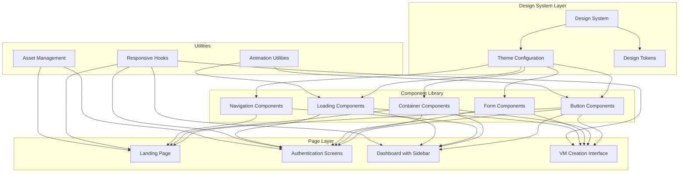

# Design Document: Frontend UI 8-Bit Redesign

## Overview

This design document outlines the technical approach for refactoring the frontend UI to implement a comprehensive 8-bit/retro pixel art aesthetic with responsive design capabilities. The redesign transforms the visual presentation while maintaining all existing functionality and improving user experience through better navigation patterns and visual feedback.

The design follows a component-based architecture using React and TypeScript, with a centralized design system that ensures consistency across all screens. The implementation leverages CSS-in-JS or Tailwind CSS for styling, with careful attention to responsive breakpoints, accessibility, and performance optimization.

## Architecture

### High-Level Architecture



### Technology Stack

- **Frontend Framework**: React 18+ with TypeScript
- **Styling**: Tailwind CSS with custom 8-bit theme configuration
- **State Management**: React Context API or existing state solution
- **Routing**: React Router (existing)
- **Animation**: CSS animations with Framer Motion for complex interactions
- **Font Loading**: Web Font Loader for pixel fonts
- **Internationalization**: react-i18next with i18next for multi-language support
- **Build Tool**: Vite or existing build configuration
- **Testing**: Jest + React Testing Library for component tests

### Design System Architecture

The design system follows atomic design principles:

1. **Design Tokens**: Color palette, spacing scale, typography scale, border styles
2. **Atoms**: Buttons, inputs, icons, text elements
3. **Molecules**: Form fields with labels, navigation items, cards
4. **Organisms**: Navigation bar, sidebar, forms, content sections
5. **Templates**: Page layouts (landing, auth, dashboard)
6. **Pages**: Fully composed screens

## Components and Interfaces

### 1. Design System Core

#### Theme Configuration

```typescript
// theme.ts
export const theme = {
  colors: {
    primary: {
      yellow: '#DBC70F',
      yellowHsl: 'hsla(54, 87%, 45%, 1)',
    },
    accent: {
      pink: '#DB6495',
      pinkHsl: 'hsla(335, 62%, 62%, 1)',
      cyan: '#1ABBDB',
      cyanHsl: 'hsla(189, 78%, 48%, 1)',
    },
    neutral: {
      teal: '#3D7A86',
      tealHsl: 'hsla(189, 37%, 38%, 1)',
      olive: '#5C593E',
      oliveHsl: 'hsla(54, 19%, 30%, 1)',
      darkPurple: '#5C3947',
      darkPurpleHsl: 'hsla(335, 23%, 29%, 1)',
    },
  },
  
  spacing: {
    xs: '4px',
    sm: '8px',
    md: '16px',
    lg: '24px',
    xl: '32px',
    xxl: '48px',
  },
  
  typography: {
    fontFamily: {
      pixel: '"Press Start 2P", "Courier New", monospace',
    },
    fontSize: {
      xs: '8px',
      sm: '10px',
      base: '12px',
      lg: '16px',
      xl: '20px',
      xxl: '24px',
    },
    lineHeight: {
      tight: 1.2,
      normal: 1.5,
      relaxed: 1.8,
    },
  },
  
  borders: {
    pixel: {
      width: '4px',
      style: 'solid',
      radius: '0px', // No border radius for pixel aesthetic
    },
  },
  
  breakpoints: {
    mobile: '0px',
    tablet: '768px',
    desktop: '1024px',
    wide: '1440px',
  },
  
  shadows: {
    pixel: '4px 4px 0px rgba(0, 0, 0, 0.25)',
    pixelLarge: '8px 8px 0px rgba(0, 0, 0, 0.25)',
  },
};

export type Theme = typeof theme;
```

#### Design Tokens Hook

```typescript
// useTheme.ts
import { useContext } from 'react';
import { ThemeContext } from './ThemeProvider';
import { Theme } from './theme';

export const useTheme = (): Theme => {
  const context = useContext(ThemeContext);
  if (!context) {
    throw new Error('useTheme must be used within ThemeProvider');
  }
  return context;
};
```

### 2. Button Component

```typescript
// Button.tsx
import React from 'react';

export type ButtonVariant = 'normal' | 'primary' | 'success' | 'warning' | 'error';

export interface ButtonProps extends React.ButtonHTMLAttributes<HTMLButtonElement> {
  variant?: ButtonVariant;
  fullWidth?: boolean;
  children: React.ReactNode;
}

export const Button: React.FC<ButtonProps> = ({
  variant = 'normal',
  fullWidth = false,
  children,
  className = '',
  ...props
}) => {
  const baseClasses = 'font-pixel text-sm px-md py-sm border-4 border-solid transition-all hover:translate-y-[-2px] active:translate-y-[2px] disabled:opacity-50 disabled:cursor-not-allowed';
  
  const variantClasses = {
    normal: 'bg-neutral-olive border-neutral-teal text-white hover:bg-neutral-teal',
    primary: 'bg-primary-yellow border-accent-cyan text-neutral-darkPurple hover:bg-accent-cyan hover:text-white',
    success: 'bg-accent-cyan border-neutral-teal text-white hover:bg-neutral-teal',
    warning: 'bg-primary-yellow border-neutral-olive text-neutral-darkPurple hover:bg-neutral-olive hover:text-white',
    error: 'bg-accent-pink border-neutral-darkPurple text-white hover:bg-neutral-darkPurple',
  };
  
  const widthClass = fullWidth ? 'w-full' : '';
  
  return (
    <button
      className={`${baseClasses} ${variantClasses[variant]} ${widthClass} ${className}`}
      {...props}
    >
      {children}
    </button>
  );
};
```

### 3. Container Component

```typescript
// Container.tsx
import React from 'react';

export type ContainerVariant = 'light' | 'dark';

export interface ContainerProps {
  variant?: ContainerVariant;
  children: React.ReactNode;
  className?: string;
  padding?: 'sm' | 'md' | 'lg';
}

export const Container: React.FC<ContainerProps> = ({
  variant = 'light',
  children,
  className = '',
  padding = 'md',
}) => {
  const baseClasses = 'border-4 border-solid';
  
  const variantClasses = {
    light: 'bg-white border-neutral-olive',
    dark: 'bg-neutral-darkPurple border-neutral-teal text-white',
  };
  
  const paddingClasses = {
    sm: 'p-sm',
    md: 'p-md',
    lg: 'p-lg',
  };
  
  return (
    <div className={`${baseClasses} ${variantClasses[variant]} ${paddingClasses[padding]} ${className}`}>
      {children}
    </div>
  );
};
```

### 4. Form Input Component

```typescript
// Input.tsx
import React from 'react';

export interface InputProps extends React.InputHTMLAttributes<HTMLInputElement> {
  label?: string;
  error?: string;
  helperText?: string;
}

export const Input: React.FC<InputProps> = ({
  label,
  error,
  helperText,
  className = '',
  id,
  ...props
}) => {
  const inputId = id || `input-${Math.random().toString(36).substr(2, 9)}`;
  
  const inputClasses = `
    w-full px-sm py-sm
    font-pixel text-sm
    border-4 border-solid
    ${error ? 'border-accent-pink' : 'border-neutral-teal'}
    bg-white
    focus:outline-none focus:border-accent-cyan
    disabled:opacity-50 disabled:cursor-not-allowed
  `;
  
  return (
    <div className={`flex flex-col gap-xs ${className}`}>
      {label && (
        <label htmlFor={inputId} className="font-pixel text-sm text-neutral-darkPurple">
          {label}
        </label>
      )}
      <input
        id={inputId}
        className={inputClasses}
        {...props}
      />
      {error && (
        <span className="font-pixel text-xs text-accent-pink" role="alert">
          {error}
        </span>
      )}
      {helperText && !error && (
        <span className="font-pixel text-xs text-neutral-teal">
          {helperText}
        </span>
      )}
    </div>
  );
};
```

### 5. Loading Component

```typescript
// Loading.tsx
import React from 'react';

export interface LoadingProps {
  size?: 'sm' | 'md' | 'lg';
  text?: string;
}

export const Loading: React.FC<LoadingProps> = ({
  size = 'md',
  text = 'Loading...',
}) => {
  const sizeClasses = {
    sm: 'w-4 h-4',
    md: 'w-8 h-8',
    lg: 'w-12 h-12',
  };
  
  return (
    <div className="flex flex-col items-center justify-center gap-md">
      <div className={`${sizeClasses[size]} relative`}>
        {/* 8-bit style loading animation using CSS */}
        <div className="absolute inset-0 border-4 border-primary-yellow border-t-transparent animate-spin-pixel" />
      </div>
      {text && (
        <span className="font-pixel text-sm text-neutral-teal">
          {text}
        </span>
      )}
    </div>
  );
};
```

### 6. Sidebar Navigation Component

```typescript
// Sidebar.tsx
import React, { useState } from 'react';
import { Link, useLocation } from 'react-router-dom';

export interface SidebarItem {
  id: string;
  label: string;
  icon: React.ReactNode;
  path: string;
}

export interface SidebarProps {
  items: SidebarItem[];
  logo?: React.ReactNode;
  collapsible?: boolean;
}

export const Sidebar: React.FC<SidebarProps> = ({
  items,
  logo,
  collapsible = true,
}) => {
  const [isCollapsed, setIsCollapsed] = useState(false);
  const location = useLocation();
  
  const toggleCollapse = () => {
    if (collapsible) {
      setIsCollapsed(!isCollapsed);
    }
  };
  
  return (
    <aside
      className={`
        h-screen bg-neutral-darkPurple border-r-4 border-neutral-teal
        transition-all duration-300
        ${isCollapsed ? 'w-16' : 'w-64'}
        flex flex-col
      `}
    >
      {/* Logo Section */}
      <div className="p-md border-b-4 border-neutral-teal flex items-center justify-between">
        {logo && (
          <div className={`${isCollapsed ? 'hidden' : 'block'}`}>
            {logo}
          </div>
        )}
        {collapsible && (
          <button
            onClick={toggleCollapse}
            className="p-xs hover:bg-neutral-teal transition-colors"
            aria-label={isCollapsed ? 'Expand sidebar' : 'Collapse sidebar'}
          >
            <span className="text-white font-pixel text-xs">
              {isCollapsed ? '>' : '<'}
            </span>
          </button>
        )}
      </div>
      
      {/* Navigation Items */}
      <nav className="flex-1 overflow-y-auto">
        <ul className="flex flex-col">
          {items.map((item) => {
            const isActive = location.pathname === item.path;
            return (
              <li key={item.id}>
                <Link
                  to={item.path}
                  className={`
                    flex items-center gap-md p-md
                    font-pixel text-sm
                    transition-colors
                    ${isActive 
                      ? 'bg-accent-cyan text-white border-l-4 border-primary-yellow' 
                      : 'text-white hover:bg-neutral-teal'
                    }
                  `}
                >
                  <span className="flex-shrink-0">{item.icon}</span>
                  {!isCollapsed && <span>{item.label}</span>}
                </Link>
              </li>
            );
          })}
        </ul>
      </nav>
    </aside>
  );
};
```

### 7. Responsive Hook

```typescript
// useResponsive.ts
import { useState, useEffect } from 'react';

export type Breakpoint = 'mobile' | 'tablet' | 'desktop' | 'wide';

export const useResponsive = () => {
  const [breakpoint, setBreakpoint] = useState<Breakpoint>('mobile');
  const [isMobile, setIsMobile] = useState(true);
  const [isTablet, setIsTablet] = useState(false);
  const [isDesktop, setIsDesktop] = useState(false);
  
  useEffect(() => {
    const handleResize = () => {
      const width = window.innerWidth;
      
      if (width < 768) {
        setBreakpoint('mobile');
        setIsMobile(true);
        setIsTablet(false);
        setIsDesktop(false);
      } else if (width < 1024) {
        setBreakpoint('tablet');
        setIsMobile(false);
        setIsTablet(true);
        setIsDesktop(false);
      } else if (width < 1440) {
        setBreakpoint('desktop');
        setIsMobile(false);
        setIsTablet(false);
        setIsDesktop(true);
      } else {
        setBreakpoint('wide');
        setIsMobile(false);
        setIsTablet(false);
        setIsDesktop(true);
      }
    };
    
    handleResize();
    window.addEventListener('resize', handleResize);
    
    return () => window.removeEventListener('resize', handleResize);
  }, []);
  
  return {
    breakpoint,
    isMobile,
    isTablet,
    isDesktop,
  };
};
```

### 8. Hero Pixel Animation Component

```typescript
// HeroPixelAnimation.tsx
import React, { useEffect, useRef, useState } from 'react';

interface Particle {
  x: number;
  y: number;
  vx: number;
  vy: number;
  size: number;
  color: string;
  originalX: number;
  originalY: number;
}

export interface HeroPixelAnimationProps {
  particleCount?: number;
  repulsionRadius?: number;
  repulsionForce?: number;
  returnSpeed?: number;
  colors?: string[];
}

export const HeroPixelAnimation: React.FC<HeroPixelAnimationProps> = ({
  particleCount = 150,
  repulsionRadius = 100,
  repulsionForce = 0.5,
  returnSpeed = 0.05,
  colors = ['#DBC70F', '#DB6495', '#1ABBDB', '#3D7A86', '#5C593E', '#5C3947'],
}) => {
  const canvasRef = useRef<HTMLCanvasElement>(null);
  const particlesRef = useRef<Particle[]>([]);
  const mouseRef = useRef({ x: -1000, y: -1000 });
  const animationFrameRef = useRef<number>();
  const [isInitialized, setIsInitialized] = useState(false);

  // Initialize particles
  useEffect(() => {
    const canvas = canvasRef.current;
    if (!canvas) return;

    const initParticles = () => {
      const particles: Particle[] = [];
      const width = canvas.width;
      const height = canvas.height;

      for (let i = 0; i < particleCount; i++) {
        const x = Math.random() * width;
        const y = Math.random() * height;
        particles.push({
          x,
          y,
          vx: 0,
          vy: 0,
          size: Math.random() * 3 + 2, // 2-5px pixel size
          color: colors[Math.floor(Math.random() * colors.length)],
          originalX: x,
          originalY: y,
        });
      }

      particlesRef.current = particles;
      setIsInitialized(true);
    };

    const handleResize = () => {
      canvas.width = canvas.offsetWidth;
      canvas.height = canvas.offsetHeight;
      initParticles();
    };

    handleResize();
    window.addEventListener('resize', handleResize);

    return () => {
      window.removeEventListener('resize', handleResize);
    };
  }, [particleCount, colors]);

  // Mouse tracking
  useEffect(() => {
    const canvas = canvasRef.current;
    if (!canvas) return;

    const handleMouseMove = (e: MouseEvent) => {
      const rect = canvas.getBoundingClientRect();
      mouseRef.current = {
        x: e.clientX - rect.left,
        y: e.clientY - rect.top,
      };
    };

    const handleMouseLeave = () => {
      mouseRef.current = { x: -1000, y: -1000 };
    };

    canvas.addEventListener('mousemove', handleMouseMove);
    canvas.addEventListener('mouseleave', handleMouseLeave);

    return () => {
      canvas.removeEventListener('mousemove', handleMouseMove);
      canvas.removeEventListener('mouseleave', handleMouseLeave);
    };
  }, []);

  // Animation loop
  useEffect(() => {
    if (!isInitialized) return;

    const canvas = canvasRef.current;
    const ctx = canvas?.getContext('2d');
    if (!canvas || !ctx) return;

    const animate = () => {
      ctx.clearRect(0, 0, canvas.width, canvas.height);

      const particles = particlesRef.current;
      const mouse = mouseRef.current;

      particles.forEach((particle) => {
        // Calculate distance from mouse
        const dx = particle.x - mouse.x;
        const dy = particle.y - mouse.y;
        const distance = Math.sqrt(dx * dx + dy * dy);

        // Apply repulsion force if within radius
        if (distance < repulsionRadius) {
          const force = (1 - distance / repulsionRadius) * repulsionForce;
          const angle = Math.atan2(dy, dx);
          particle.vx += Math.cos(angle) * force;
          particle.vy += Math.sin(angle) * force;
        }

        // Return to original position
        const returnDx = particle.originalX - particle.x;
        const returnDy = particle.originalY - particle.y;
        particle.vx += returnDx * returnSpeed;
        particle.vy += returnDy * returnSpeed;

        // Apply velocity with damping
        particle.vx *= 0.95;
        particle.vy *= 0.95;
        particle.x += particle.vx;
        particle.y += particle.vy;

        // Draw pixel (square for 8-bit aesthetic)
        ctx.fillStyle = particle.color;
        ctx.fillRect(
          Math.floor(particle.x),
          Math.floor(particle.y),
          particle.size,
          particle.size
        );
      });

      animationFrameRef.current = requestAnimationFrame(animate);
    };

    animate();

    return () => {
      if (animationFrameRef.current) {
        cancelAnimationFrame(animationFrameRef.current);
      }
    };
  }, [isInitialized, repulsionRadius, repulsionForce, returnSpeed]);

  return (
    <canvas
      ref={canvasRef}
      className="absolute inset-0 w-full h-full pointer-events-auto"
      style={{ imageRendering: 'pixelated' }}
    />
  );
};
```

## Data Models

### Theme Context

```typescript
// ThemeProvider.tsx
import React, { createContext, ReactNode } from 'react';
import { theme, Theme } from './theme';

export const ThemeContext = createContext<Theme | undefined>(undefined);

export interface ThemeProviderProps {
  children: ReactNode;
}

export const ThemeProvider: React.FC<ThemeProviderProps> = ({ children }) => {
  return (
    <ThemeContext.Provider value={theme}>
      {children}
    </ThemeContext.Provider>
  );
};
```

### Navigation Configuration

```typescript
// navigationConfig.ts
export interface NavigationConfig {
  sidebarItems: Array<{
    id: string;
    label: string;
    icon: string; // Icon name or component
    path: string;
    requiresAuth?: boolean;
  }>;
  
  headerItems: Array<{
    id: string;
    label: string;
    path: string;
    variant?: 'normal' | 'primary';
  }>;
}

export const defaultNavigationConfig: NavigationConfig = {
  sidebarItems: [
    { id: 'dashboard', label: 'Dashboard', icon: 'dashboard', path: '/dashboard' },
    { id: 'vms', label: 'Virtual Machines', icon: 'vm', path: '/vms' },
    { id: 'create-vm', label: 'Create VM', icon: 'add', path: '/vms/create' },
    { id: 'settings', label: 'Settings', icon: 'settings', path: '/settings' },
  ],
  
  headerItems: [
    { id: 'explore', label: 'Explore', path: '/explore', variant: 'normal' },
    { id: 'login', label: 'Login', path: '/login', variant: 'primary' },
  ],
};
```

### Page Layout Models

```typescript
// layouts.ts
export interface PageLayout {
  type: 'landing' | 'auth' | 'dashboard' | 'fullscreen';
  showHeader: boolean;
  showSidebar: boolean;
  showFooter: boolean;
  containerVariant: 'light' | 'dark';
  backgroundGradient?: string;
}

export const layoutConfigs: Record<string, PageLayout> = {
  landing: {
    type: 'landing',
    showHeader: true,
    showSidebar: false,
    showFooter: true,
    containerVariant: 'light',
    backgroundGradient: 'linear-gradient(135deg, #5C3947 0%, #DB6495 50%, #DBC70F 100%)',
  },
  
  auth: {
    type: 'auth',
    showHeader: false,
    showSidebar: false,
    showFooter: false,
    containerVariant: 'light',
    backgroundGradient: 'linear-gradient(135deg, #5C3947 0%, #DB6495 100%)',
  },
  
  dashboard: {
    type: 'dashboard',
    showHeader: false,
    showSidebar: true,
    showFooter: false,
    containerVariant: 'light',
  },
  
  fullscreen: {
    type: 'fullscreen',
    showHeader: false,
    showSidebar: false,
    showFooter: false,
    containerVariant: 'dark',
  },
};
```

### Internationalization Configuration

```typescript
// i18n.ts
import i18n from 'i18next';
import { initReactI18next } from 'react-i18next';
import LanguageDetector from 'i18next-browser-languagedetector';

// Translation resources
import enTranslations from './locales/en.json';
import jaTranslations from './locales/ja.json';
import esTranslations from './locales/es.json';

export const resources = {
  en: { translation: enTranslations },
  ja: { translation: jaTranslations },
  es: { translation: esTranslations },
} as const;

export type Locale = 'en' | 'ja' | 'es';

export const supportedLocales: Locale[] = ['en', 'ja', 'es'];

export const localeNames: Record<Locale, string> = {
  en: 'English',
  ja: '日本語',
  es: 'Español',
};

i18n
  .use(LanguageDetector)
  .use(initReactI18next)
  .init({
    resources,
    fallbackLng: 'en',
    supportedLngs: supportedLocales,
    interpolation: {
      escapeValue: false,
    },
    detection: {
      order: ['localStorage', 'navigator'],
      caches: ['localStorage'],
      lookupLocalStorage: 'i18nextLng',
    },
  });

export default i18n;
```

### Translation Files Structure

```typescript
// locales/en.json
{
  "nav": {
    "home": "Home",
    "explore": "Explore",
    "login": "Login",
    "signup": "Sign Up",
    "dashboard": "Dashboard",
    "vms": "Virtual Machines",
    "createVm": "Create VM",
    "settings": "Settings"
  },
  "landing": {
    "hero": {
      "title": "Welcome to CTF Automation Platform",
      "subtitle": "Launch and manage your CTF environments with ease",
      "ctaExplore": "Explore",
      "ctaJoin": "Join Community"
    }
  },
  "auth": {
    "login": {
      "title": "Login",
      "email": "Email",
      "password": "Password",
      "rememberMe": "Remember me",
      "forgotPassword": "Forgot password?",
      "submit": "Login",
      "switchToSignup": "Don't have an account? Sign up"
    },
    "signup": {
      "title": "Sign Up",
      "name": "Name",
      "email": "Email",
      "password": "Password",
      "confirmPassword": "Confirm Password",
      "submit": "Sign Up",
      "switchToLogin": "Already have an account? Login"
    }
  },
  "vm": {
    "create": {
      "title": "Create Virtual Machine",
      "basicInfo": "Basic Information",
      "name": "VM Name",
      "os": "Operating System",
      "resources": "Resources",
      "cpu": "CPU Cores",
      "ram": "RAM (GB)",
      "storage": "Storage (GB)",
      "network": "Network Configuration",
      "setupMode": "Setup Mode",
      "setupModeGemini": "Gemini CLI",
      "setupModeManual": "Manual",
      "setupModeGeminiDesc": "Pre-configured with Gemini CLI for AI-powered development",
      "setupModeManualDesc": "Basic tools and SSH access - configure your own environment",
      "advanced": "Advanced Options",
      "submit": "Create VM",
      "cancel": "Cancel"
    },
    "list": {
      "title": "Agent Sessions",
      "noSessions": "No active sessions",
      "setupMode": "Setup Mode",
      "status": "Status",
      "actions": "Actions"
    },
    "delete": {
      "button": "Delete Infrastructure",
      "modalTitle": "Delete Agent Infrastructure",
      "warning": "This action will permanently destroy all cloud resources associated with this session.",
      "sessionIdLabel": "Enter Session ID to confirm",
      "sessionIdPlaceholder": "Type session ID here",
      "confirmPhraseLabel": "Type the confirmation phrase",
      "confirmPhrasePlaceholder": "delete agent infrastructure",
      "confirmPhraseRequired": "delete agent infrastructure",
      "submit": "Delete Infrastructure",
      "cancel": "Cancel",
      "deleting": "Deleting infrastructure...",
      "success": "Infrastructure deleted successfully",
      "error": "Failed to delete infrastructure"
    }
  },
  "errors": {
    "required": "This field is required",
    "invalidEmail": "Invalid email address",
    "passwordMismatch": "Passwords do not match",
    "networkError": "Network error. Please try again.",
    "authFailed": "Authentication failed. Please check your credentials."
  },
  "common": {
    "loading": "Loading...",
    "back": "Back",
    "save": "Save",
    "cancel": "Cancel",
    "delete": "Delete",
    "edit": "Edit",
    "close": "Close"
  }
}

// locales/ja.json
{
  "nav": {
    "home": "ホーム",
    "explore": "探索",
    "login": "ログイン",
    "signup": "サインアップ",
    "dashboard": "ダッシュボード",
    "vms": "仮想マシン",
    "createVm": "VM作成",
    "settings": "設定"
  },
  "landing": {
    "hero": {
      "title": "CTF自動化プラットフォームへようこそ",
      "subtitle": "CTF環境を簡単に起動・管理",
      "ctaExplore": "探索",
      "ctaJoin": "コミュニティに参加"
    }
  },
  "auth": {
    "login": {
      "title": "ログイン",
      "email": "メールアドレス",
      "password": "パスワード",
      "rememberMe": "ログイン状態を保持",
      "forgotPassword": "パスワードをお忘れですか？",
      "submit": "ログイン",
      "switchToSignup": "アカウントをお持ちでない方はこちら"
    },
    "signup": {
      "title": "サインアップ",
      "name": "名前",
      "email": "メールアドレス",
      "password": "パスワード",
      "confirmPassword": "パスワード確認",
      "submit": "サインアップ",
      "switchToLogin": "既にアカウントをお持ちの方はこちら"
    }
  },
  "vm": {
    "create": {
      "title": "仮想マシンを作成",
      "basicInfo": "基本情報",
      "name": "VM名",
      "os": "オペレーティングシステム",
      "resources": "リソース",
      "cpu": "CPUコア数",
      "ram": "RAM (GB)",
      "storage": "ストレージ (GB)",
      "network": "ネットワーク設定",
      "setupMode": "セットアップモード",
      "setupModeGemini": "Gemini CLI",
      "setupModeManual": "マニュアル",
      "setupModeGeminiDesc": "AI開発支援のためのGemini CLIが事前設定済み",
      "setupModeManualDesc": "基本ツールとSSHアクセスのみ - 独自の環境を設定",
      "advanced": "詳細オプション",
      "submit": "VM作成",
      "cancel": "キャンセル"
    },
    "list": {
      "title": "エージェントセッション",
      "noSessions": "アクティブなセッションがありません",
      "setupMode": "セットアップモード",
      "status": "ステータス",
      "actions": "アクション"
    },
    "delete": {
      "button": "インフラストラクチャを削除",
      "modalTitle": "エージェントインフラストラクチャを削除",
      "warning": "このアクションは、このセッションに関連するすべてのクラウドリソースを完全に破棄します。",
      "sessionIdLabel": "確認のためセッションIDを入力",
      "sessionIdPlaceholder": "セッションIDを入力",
      "confirmPhraseLabel": "確認フレーズを入力",
      "confirmPhrasePlaceholder": "delete agent infrastructure",
      "confirmPhraseRequired": "delete agent infrastructure",
      "submit": "インフラストラクチャを削除",
      "cancel": "キャンセル",
      "deleting": "インフラストラクチャを削除中...",
      "success": "インフラストラクチャが正常に削除されました",
      "error": "インフラストラクチャの削除に失敗しました"
    }
  },
  "errors": {
    "required": "この項目は必須です",
    "invalidEmail": "無効なメールアドレスです",
    "passwordMismatch": "パスワードが一致しません",
    "networkError": "ネットワークエラーが発生しました。もう一度お試しください。",
    "authFailed": "認証に失敗しました。認証情報を確認してください。"
  },
  "common": {
    "loading": "読み込み中...",
    "back": "戻る",
    "save": "保存",
    "cancel": "キャンセル",
    "delete": "削除",
    "edit": "編集",
    "close": "閉じる"
  }
}

// locales/es.json
{
  "nav": {
    "home": "Inicio",
    "explore": "Explorar",
    "login": "Iniciar Sesión",
    "signup": "Registrarse",
    "dashboard": "Panel",
    "vms": "Máquinas Virtuales",
    "createVm": "Crear VM",
    "settings": "Configuración"
  },
  "landing": {
    "hero": {
      "title": "Bienvenido a la Plataforma de Automatización CTF",
      "subtitle": "Lanza y gestiona tus entornos CTF con facilidad",
      "ctaExplore": "Explorar",
      "ctaJoin": "Unirse a la Comunidad"
    }
  },
  "auth": {
    "login": {
      "title": "Iniciar Sesión",
      "email": "Correo Electrónico",
      "password": "Contraseña",
      "rememberMe": "Recordarme",
      "forgotPassword": "¿Olvidaste tu contraseña?",
      "submit": "Iniciar Sesión",
      "switchToSignup": "¿No tienes cuenta? Regístrate"
    },
    "signup": {
      "title": "Registrarse",
      "name": "Nombre",
      "email": "Correo Electrónico",
      "password": "Contraseña",
      "confirmPassword": "Confirmar Contraseña",
      "submit": "Registrarse",
      "switchToLogin": "¿Ya tienes cuenta? Inicia sesión"
    }
  },
  "vm": {
    "create": {
      "title": "Crear Máquina Virtual",
      "basicInfo": "Información Básica",
      "name": "Nombre de VM",
      "os": "Sistema Operativo",
      "resources": "Recursos",
      "cpu": "Núcleos de CPU",
      "ram": "RAM (GB)",
      "storage": "Almacenamiento (GB)",
      "network": "Configuración de Red",
      "setupMode": "Modo de Configuración",
      "setupModeGemini": "Gemini CLI",
      "setupModeManual": "Manual",
      "setupModeGeminiDesc": "Preconfigurado con Gemini CLI para desarrollo asistido por IA",
      "setupModeManualDesc": "Herramientas básicas y acceso SSH - configura tu propio entorno",
      "advanced": "Opciones Avanzadas",
      "submit": "Crear VM",
      "cancel": "Cancelar"
    },
    "list": {
      "title": "Sesiones de Agente",
      "noSessions": "No hay sesiones activas",
      "setupMode": "Modo de Configuración",
      "status": "Estado",
      "actions": "Acciones"
    },
    "delete": {
      "button": "Eliminar Infraestructura",
      "modalTitle": "Eliminar Infraestructura del Agente",
      "warning": "Esta acción destruirá permanentemente todos los recursos en la nube asociados con esta sesión.",
      "sessionIdLabel": "Ingresa el ID de sesión para confirmar",
      "sessionIdPlaceholder": "Escribe el ID de sesión aquí",
      "confirmPhraseLabel": "Escribe la frase de confirmación",
      "confirmPhrasePlaceholder": "delete agent infrastructure",
      "confirmPhraseRequired": "delete agent infrastructure",
      "submit": "Eliminar Infraestructura",
      "cancel": "Cancelar",
      "deleting": "Eliminando infraestructura...",
      "success": "Infraestructura eliminada exitosamente",
      "error": "Error al eliminar la infraestructura"
    }
  },
  "errors": {
    "required": "Este campo es obligatorio",
    "invalidEmail": "Dirección de correo electrónico no válida",
    "passwordMismatch": "Las contraseñas no coinciden",
    "networkError": "Error de red. Por favor, inténtalo de nuevo.",
    "authFailed": "Autenticación fallida. Por favor, verifica tus credenciales."
  },
  "common": {
    "loading": "Cargando...",
    "back": "Volver",
    "save": "Guardar",
    "cancel": "Cancelar",
    "delete": "Eliminar",
    "edit": "Editar",
    "close": "Cerrar"
  }
}
```

### Language Selector Component

```typescript
// LanguageSelector.tsx
import React from 'react';
import { useTranslation } from 'react-i18next';
import { Locale, localeNames, supportedLocales } from './i18n';

export const LanguageSelector: React.FC = () => {
  const { i18n } = useTranslation();
  const currentLocale = i18n.language as Locale;

  const handleLanguageChange = (locale: Locale) => {
    i18n.changeLanguage(locale);
  };

  return (
    <div className="relative inline-block">
      <select
        value={currentLocale}
        onChange={(e) => handleLanguageChange(e.target.value as Locale)}
        className="
          font-pixel text-sm px-sm py-xs
          border-4 border-solid border-neutral-teal
          bg-white text-neutral-darkPurple
          focus:outline-none focus:border-accent-cyan
          cursor-pointer
        "
        aria-label="Select language"
      >
        {supportedLocales.map((locale) => (
          <option key={locale} value={locale}>
            {localeNames[locale]}
          </option>
        ))}
      </select>
    </div>
  );
};
```


## Correctness Properties

A property is a characteristic or behavior that should hold true across all valid executions of a system—essentially, a formal statement about what the system should do. Properties serve as the bridge between human-readable specifications and machine-verifiable correctness guarantees.

### Property 1: Responsive Breakpoint Detection

*For any* viewport width, the responsive hook should correctly identify the breakpoint category (mobile for width < 768px, tablet/desktop for width >= 768px), and this categorization should remain consistent across multiple resize events.

**Validates: Requirements 2.1, 2.2, 2.5**

### Property 2: Component Styling Consistency

*For any* design system component (Button, Container, Input, Loading), when rendered, the component should automatically apply 8-bit styling classes including pixel fonts, pixelated borders, and theme colors without requiring additional props.

**Validates: Requirements 3.6**

### Property 3: Navigation Behavior

*For any* navigation action (clicking CTA buttons, sidebar items, or back buttons), the application should trigger the correct navigation event and update the URL to the expected destination without page reload.

**Validates: Requirements 4.5, 7.9, 8.5**

### Property 23: Hero Animation Mouse Interaction

*For any* mouse movement over the landing page hero section, the pixel particles should respond by moving away from the cursor position, and the animation should maintain smooth performance (60fps) regardless of the number of particles or movement speed.

**Validates: Requirements 4.8, 4.9, 4.11**

### Property 4: Authentication Screen Responsive Layout

*For any* viewport size, the authentication screen should render in split-screen layout when width >= 768px and stacked layout when width < 768px, with all form elements remaining accessible in both layouts.

**Validates: Requirements 5.1, 5.2**

### Property 5: Authentication Mode Toggle

*For any* authentication screen state, clicking the mode toggle should switch between login and sign-up modes, updating the form fields and submit button text accordingly, and this should work bidirectionally (login ↔ sign-up).

**Validates: Requirements 5.6**

### Property 6: Loading State Display

*For any* asynchronous operation (authentication, VM creation, data fetching) that exceeds 300 milliseconds, the application should display a loading indicator using the Loading component, and should hide the indicator when the operation completes or fails.

**Validates: Requirements 5.7, 6.6, 10.1, 10.4**

### Property 7: Loading State Interaction Prevention

*For any* page or component in a loading state, user interactions with the loading content should be prevented (disabled or blocked) until the loading completes.

**Validates: Requirements 10.3**

### Property 8: Error Message Display

*For any* error condition (authentication failure, VM creation failure, network failure), the application should display an error message styled with Error variant colors from the design system.

**Validates: Requirements 5.8, 6.7, 9.1, 9.3**

### Property 9: Form Validation Feedback

*For any* form with validation rules, when validation fails, all invalid fields should be highlighted with Error styling and display specific error messages, and when validation passes, error styling should be removed.

**Validates: Requirements 9.2**

### Property 10: Dismissible Error Handling

*For any* dismissible error message, clicking the close button should remove the error from the display, and the error should not reappear unless the error condition occurs again.

**Validates: Requirements 9.5**

### Property 11: Sidebar Responsive Behavior

*For any* viewport size on the dashboard, the sidebar should display as a full vertical navigation on desktop (width >= 768px) and collapse into a hamburger menu on mobile (width < 768px), with all navigation items remaining accessible in both states.

**Validates: Requirements 7.3**

### Property 12: Active Navigation Highlighting

*For any* current route in the application, the corresponding navigation item (in sidebar or header) should be visually highlighted with distinct styling (background color, border, or text color) to indicate the active state.

**Validates: Requirements 7.5, 8.6**

### Property 13: Sidebar Collapse Toggle

*For any* sidebar state (expanded or collapsed) on desktop viewport, clicking the collapse/expand button should toggle the sidebar width between full (256px) and collapsed (64px), and this should work bidirectionally without losing navigation functionality.

**Validates: Requirements 7.10**

### Property 14: Logo Placeholder Fallback

*For any* navigation component, when no logo prop is provided, a placeholder SVG should be displayed in the logo area, and when a logo prop is provided, the actual logo should replace the placeholder.

**Validates: Requirements 8.3**

### Property 15: Conditional Back Button Display

*For any* route in the application, a back button should be displayed when the route is not the root path and not within the dashboard interface, and clicking the back button should navigate to the previous page in the browser history.

**Validates: Requirements 8.4, 8.5**

### Property 16: Accessibility - Keyboard Navigation

*For any* interactive element (buttons, links, form inputs, navigation items), the element should be reachable and operable using only keyboard navigation (Tab, Enter, Space keys), and focus order should follow logical reading order.

**Validates: Requirements 11.2**

### Property 17: Accessibility - ARIA Labels

*For any* non-text interactive element (icons, buttons without text, complex widgets), the element should include appropriate ARIA labels (aria-label, aria-labelledby, or aria-describedby) to provide context for screen readers.

**Validates: Requirements 11.3**

### Property 18: Accessibility - Form Labels

*For any* form input element, the input should have an associated label element (using htmlFor/id relationship or wrapping label) that describes the input's purpose.

**Validates: Requirements 11.4**

### Property 19: Color Contrast Compliance

*For any* text element in the application, the color contrast ratio between text and background should meet or exceed WCAG 2.1 Level AA requirements (4.5:1 for normal text, 3:1 for large text).

**Validates: Requirements 11.1**

### Property 20: Initial Page Load Performance

*For any* page in the application, the initial content should be visible and interactive within 3 seconds on a standard broadband connection (measured from navigation start to first contentful paint and time to interactive).

**Validates: Requirements 12.1**

### Property 21: Lazy Loading Images

*For any* image asset (Pixel_Art_Element graphics) that is not in the initial viewport, the image should use lazy loading (loading="lazy" attribute or Intersection Observer) to defer loading until the image is about to enter the viewport.

**Validates: Requirements 12.2**

### Property 22: Animation Performance

*For any* CSS animation or transition in the application, the animation should maintain 60 frames per second (16.67ms per frame) during execution, measured using browser performance APIs.

**Validates: Requirements 12.4**

### Property 24: Language Switching

*For any* language selection change, all visible text in the application should update to the selected language immediately, and the language preference should persist across browser sessions.

**Validates: Requirements 14.3, 14.4, 14.5**

### Property 25: Setup Mode Selection

*For any* VM creation with a selected setup mode (Gemini CLI or Manual), the created Agent_Session should be provisioned with the appropriate tools and configuration matching the selected mode.

**Validates: Requirements 15.2, 15.3**

### Property 26: Infrastructure Deletion Confirmation

*For any* deletion attempt, the infrastructure should only be deleted when both the exact session ID and the exact confirmation phrase "delete agent infrastructure" are entered correctly, preventing accidental deletions.

**Validates: Requirements 16.3, 16.4, 16.6, 16.7**

### Property 24: Language Selection Persistence

*For any* language selection made by the user, the selected locale should be persisted in browser storage and automatically loaded when the user returns to the application.

**Validates: Requirements 14.4, 14.5**

### Property 25: Translation Completeness

*For any* UI text element (buttons, labels, messages, navigation items), when the user switches languages, the text should update to the selected language, or fall back to English if the translation is missing.

**Validates: Requirements 14.3, 14.7, 14.10**

### Property 26: Locale-Specific Formatting

*For any* date, number, or currency value displayed in the application, the formatting should match the conventions of the selected locale (e.g., date format, decimal separator, currency symbol).

**Validates: Requirements 14.9**

## Error Handling

### Error Categories

1. **Network Errors**: Failed API requests, timeout errors, connection issues
2. **Validation Errors**: Form validation failures, invalid input data
3. **Authentication Errors**: Invalid credentials, expired sessions, authorization failures
4. **Resource Errors**: Failed image loading, missing assets
5. **Runtime Errors**: JavaScript exceptions, component rendering errors

### Error Handling Strategy

#### Network Error Handling

```typescript
// errorHandler.ts
export interface NetworkError {
  type: 'network';
  message: string;
  statusCode?: number;
  retryable: boolean;
}

export const handleNetworkError = (error: unknown): NetworkError => {
  if (error instanceof Response) {
    return {
      type: 'network',
      message: `Request failed with status ${error.status}`,
      statusCode: error.status,
      retryable: error.status >= 500,
    };
  }
  
  return {
    type: 'network',
    message: 'Network request failed. Please check your connection.',
    retryable: true,
  };
};
```

#### Form Validation Error Handling

```typescript
// validation.ts
export interface ValidationError {
  field: string;
  message: string;
}

export interface ValidationResult {
  isValid: boolean;
  errors: ValidationError[];
}

export const validateForm = (
  values: Record<string, any>,
  rules: Record<string, (value: any) => string | null>
): ValidationResult => {
  const errors: ValidationError[] = [];
  
  for (const [field, rule] of Object.entries(rules)) {
    const error = rule(values[field]);
    if (error) {
      errors.push({ field, message: error });
    }
  }
  
  return {
    isValid: errors.length === 0,
    errors,
  };
};
```

#### Error Boundary Component

```typescript
// ErrorBoundary.tsx
import React, { Component, ReactNode } from 'react';
import { Container } from './Container';
import { Button } from './Button';

interface Props {
  children: ReactNode;
  fallback?: ReactNode;
}

interface State {
  hasError: boolean;
  error?: Error;
}

export class ErrorBoundary extends Component<Props, State> {
  constructor(props: Props) {
    super(props);
    this.state = { hasError: false };
  }
  
  static getDerivedStateFromError(error: Error): State {
    return { hasError: true, error };
  }
  
  componentDidCatch(error: Error, errorInfo: React.ErrorInfo) {
    console.error('Error caught by boundary:', error, errorInfo);
  }
  
  handleReset = () => {
    this.setState({ hasError: false, error: undefined });
  };
  
  render() {
    if (this.state.hasError) {
      if (this.props.fallback) {
        return this.props.fallback;
      }
      
      return (
        <Container variant="dark" padding="lg" className="text-center">
          <h2 className="font-pixel text-lg text-accent-pink mb-md">
            Oops! Something went wrong
          </h2>
          <p className="font-pixel text-sm mb-lg">
            {this.state.error?.message || 'An unexpected error occurred'}
          </p>
          <Button variant="primary" onClick={this.handleReset}>
            Try Again
          </Button>
        </Container>
      );
    }
    
    return this.props.children;
  }
}
```

#### Error Toast Component

```typescript
// ErrorToast.tsx
import React, { useEffect } from 'react';
import { Container } from './Container';
import { Button } from './Button';

export interface ErrorToastProps {
  message: string;
  dismissible?: boolean;
  onDismiss?: () => void;
  autoHideDuration?: number;
}

export const ErrorToast: React.FC<ErrorToastProps> = ({
  message,
  dismissible = true,
  onDismiss,
  autoHideDuration,
}) => {
  useEffect(() => {
    if (autoHideDuration && onDismiss) {
      const timer = setTimeout(onDismiss, autoHideDuration);
      return () => clearTimeout(timer);
    }
  }, [autoHideDuration, onDismiss]);
  
  return (
    <Container
      variant="dark"
      padding="md"
      className="fixed bottom-4 right-4 max-w-md border-accent-pink flex items-center justify-between gap-md"
    >
      <span className="font-pixel text-sm text-accent-pink">
        {message}
      </span>
      {dismissible && onDismiss && (
        <button
          onClick={onDismiss}
          className="font-pixel text-sm text-white hover:text-accent-pink"
          aria-label="Dismiss error"
        >
          ✕
        </button>
      )}
    </Container>
  );
};
```

### Error Recovery Strategies

1. **Retry Logic**: For network errors, implement exponential backoff retry
2. **Graceful Degradation**: Show cached data or placeholder content when real data fails to load
3. **User Feedback**: Always inform users about errors with clear, actionable messages
4. **Error Logging**: Log errors to monitoring service for debugging
5. **Fallback UI**: Provide alternative UI when components fail to render

## Testing Strategy

### Dual Testing Approach

This project requires both unit testing and property-based testing to ensure comprehensive coverage:

- **Unit tests**: Verify specific examples, edge cases, and error conditions
- **Property tests**: Verify universal properties across all inputs

Both testing approaches are complementary and necessary for comprehensive coverage. Unit tests catch concrete bugs in specific scenarios, while property tests verify general correctness across a wide range of inputs.

### Unit Testing Strategy

Unit tests should focus on:

1. **Specific Examples**: Test concrete scenarios that demonstrate correct behavior
   - Landing page renders with expected sections
   - Authentication form displays required fields
   - Sidebar contains configured navigation items

2. **Edge Cases**: Test boundary conditions and unusual inputs
   - Empty form submissions
   - Very long text inputs
   - Missing optional props

3. **Error Conditions**: Test error handling paths
   - Network request failures
   - Invalid form data
   - Component rendering errors

4. **Integration Points**: Test component interactions
   - Form submission triggers API calls
   - Navigation updates URL and renders new page
   - Theme provider supplies theme to components

### Property-Based Testing Strategy

Property-based testing will be implemented using **fast-check** library for TypeScript/JavaScript. Each property test must:

- Run minimum 100 iterations per test (due to randomization)
- Reference its corresponding design document property
- Use tag format: **Feature: frontend-ui-8bit-redesign, Property {number}: {property_text}**

#### Property Test Configuration

```typescript
// test-config.ts
import fc from 'fast-check';

export const propertyTestConfig = {
  numRuns: 100,
  verbose: true,
  seed: Date.now(),
};

export const runPropertyTest = <T>(
  propertyNumber: number,
  propertyDescription: string,
  arbitrary: fc.Arbitrary<T>,
  predicate: (value: T) => boolean | void
) => {
  it(`Feature: frontend-ui-8bit-redesign, Property ${propertyNumber}: ${propertyDescription}`, () => {
    fc.assert(
      fc.property(arbitrary, predicate),
      propertyTestConfig
    );
  });
};
```

#### Example Property Tests

```typescript
// Button.property.test.tsx
import { render } from '@testing-library/react';
import fc from 'fast-check';
import { Button, ButtonVariant } from './Button';
import { runPropertyTest } from './test-config';

describe('Button Component Properties', () => {
  runPropertyTest(
    2,
    'Component Styling Consistency',
    fc.record({
      variant: fc.constantFrom<ButtonVariant>('normal', 'primary', 'success', 'warning', 'error'),
      text: fc.string({ minLength: 1, maxLength: 50 }),
    }),
    ({ variant, text }) => {
      const { container } = render(<Button variant={variant}>{text}</Button>);
      const button = container.querySelector('button');
      
      // Verify 8-bit styling is applied
      expect(button).toHaveClass('font-pixel');
      expect(button).toHaveClass('border-4');
      expect(button).toHaveClass('border-solid');
    }
  );
});
```

```typescript
// useResponsive.property.test.ts
import { renderHook } from '@testing-library/react';
import fc from 'fast-check';
import { useResponsive } from './useResponsive';
import { runPropertyTest } from './test-config';

describe('Responsive Hook Properties', () => {
  runPropertyTest(
    1,
    'Responsive Breakpoint Detection',
    fc.integer({ min: 320, max: 2560 }),
    (width) => {
      // Mock window.innerWidth
      Object.defineProperty(window, 'innerWidth', {
        writable: true,
        configurable: true,
        value: width,
      });
      
      window.dispatchEvent(new Event('resize'));
      
      const { result } = renderHook(() => useResponsive());
      
      // Verify correct breakpoint detection
      if (width < 768) {
        expect(result.current.isMobile).toBe(true);
        expect(result.current.isDesktop).toBe(false);
      } else {
        expect(result.current.isMobile).toBe(false);
        expect(result.current.isDesktop).toBe(true);
      }
    }
  );
});
```

### Testing Tools and Libraries

- **Jest**: Test runner and assertion library
- **React Testing Library**: Component testing utilities
- **fast-check**: Property-based testing library
- **@testing-library/user-event**: User interaction simulation
- **jest-axe**: Accessibility testing
- **jest-dom**: Custom DOM matchers

### Test Coverage Goals

- **Unit Test Coverage**: Minimum 80% code coverage
- **Property Test Coverage**: All 22 correctness properties must have corresponding property tests
- **Integration Test Coverage**: All critical user flows (authentication, VM creation, navigation)
- **Accessibility Test Coverage**: All interactive components tested with jest-axe

### Continuous Integration

Tests should run automatically on:
- Every pull request
- Every commit to main branch
- Nightly builds for extended property test runs (1000+ iterations)

### Performance Testing

Performance properties (20, 22) require specialized testing:

```typescript
// performance.test.ts
describe('Performance Properties', () => {
  it('Feature: frontend-ui-8bit-redesign, Property 20: Initial Page Load Performance', async () => {
    const startTime = performance.now();
    
    // Render application
    render(<App />);
    
    // Wait for first contentful paint
    await waitFor(() => {
      expect(screen.getByTestId('main-content')).toBeInTheDocument();
    });
    
    const endTime = performance.now();
    const loadTime = endTime - startTime;
    
    // Should load within 3 seconds (3000ms)
    expect(loadTime).toBeLessThan(3000);
  });
  
  it('Feature: frontend-ui-8bit-redesign, Property 22: Animation Performance', () => {
    const { container } = render(<Loading />);
    
    // Measure frame rate during animation
    let frameCount = 0;
    const startTime = performance.now();
    
    const measureFrames = () => {
      frameCount++;
      const elapsed = performance.now() - startTime;
      
      if (elapsed < 1000) {
        requestAnimationFrame(measureFrames);
      } else {
        // Should achieve ~60 FPS
        expect(frameCount).toBeGreaterThanOrEqual(55);
      }
    };
    
    requestAnimationFrame(measureFrames);
  });
});
```

### Accessibility Testing

```typescript
// accessibility.test.tsx
import { render } from '@testing-library/react';
import { axe, toHaveNoViolations } from 'jest-axe';

expect.extend(toHaveNoViolations);

describe('Accessibility Properties', () => {
  it('Feature: frontend-ui-8bit-redesign, Property 16: Keyboard Navigation', () => {
    const { container } = render(<Sidebar items={mockItems} />);
    
    // All interactive elements should be keyboard accessible
    const interactiveElements = container.querySelectorAll('a, button, input');
    interactiveElements.forEach(element => {
      expect(element).not.toHaveAttribute('tabindex', '-1');
    });
  });
  
  it('Feature: frontend-ui-8bit-redesign, Property 17: ARIA Labels', async () => {
    const { container } = render(<Navigation />);
    
    // Run axe accessibility tests
    const results = await axe(container);
    expect(results).toHaveNoViolations();
  });
  
  it('Feature: frontend-ui-8bit-redesign, Property 19: Color Contrast Compliance', () => {
    // Test color contrast ratios
    const contrastRatios = {
      'primary-yellow-on-dark': calculateContrast('#DBC70F', '#5C3947'),
      'white-on-dark-purple': calculateContrast('#FFFFFF', '#5C3947'),
      'pink-on-white': calculateContrast('#DB6495', '#FFFFFF'),
    };
    
    Object.entries(contrastRatios).forEach(([name, ratio]) => {
      // WCAG AA requires 4.5:1 for normal text
      expect(ratio).toBeGreaterThanOrEqual(4.5);
    });
  });
});
```
