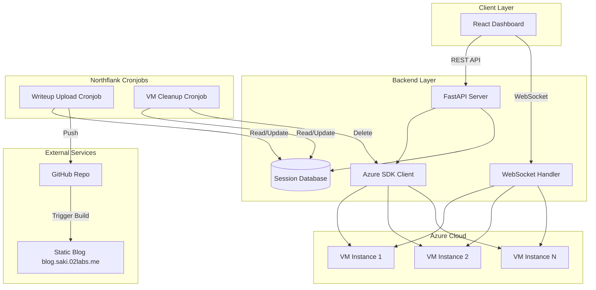

# Design Document: CTF Automation Platform Enhancements

## Overview

This design document extends the existing CTF Challenge Automation Platform with four major enhancements: support for additional AI agents (Gemini CLI and Mistral Vibe CLI), manual VM mode without AI agents, automated writeup uploads to a static blog via cronjob, and automated VM cleanup via cronjob. These enhancements build upon the existing architecture while introducing new components and modifying existing ones.

The enhancements maintain backward compatibility with existing Codex and Copilot agents while expanding the platform's capabilities. The cronjobs are designed to run on Northflank as containerized applications, providing reliable scheduled execution with proper error handling and monitoring.

## Architecture

### Enhanced System Architecture



### Component Architecture Updates

The system extends the existing four-layer architecture with additional cronjob components:

1. **Authentication Layer** (unchanged)
   - Login component with 2FA
   - User management component (admin only)
   - JWT token management
   - Session management

2. **Frontend Layer (React)** (enhanced)
   - Dashboard component with support for new agent types
   - VM creation form with Gemini CLI, Mistral Vibe CLI, and Manual options
   - Session detail component adapted for manual mode

3. **Backend Layer (Python FastAPI)** (enhanced)
   - Authentication and authorization middleware
   - REST API endpoints supporting new agent types
   - WebSocket endpoints for terminal connections
   - Azure VM management service
   - Session persistence service (updated models)
   - SSH key management service
   - User management service
   - Email notification service
   - Enhanced VM setup service for new agents

4. **Infrastructure Layer (Azure)** (unchanged)
   - Virtual machines with configurable resources
   - Network security groups for SSH access
   - Storage for VM disks

5. **Cronjob Layer (New)**
   - Writeup Upload Service: Containerized application for uploading writeups to GitHub
   - VM Cleanup Service: Containerized application for deleting expired VMs
   - Both deployed on Northflank with scheduled execution

## Components and Interfaces

### Enhanced Frontend Components

#### 1. Updated VM Creation Form Component
**Purpose**: Collect VM configuration with new agent options

**State Updates**:
- `agentType`: Extended to include 'gemini-cli', 'mistral-vibe-cli', 'manual'
- `agentModel`: Nullable for 'manual' mode
- `showModelSelect`: Boolean to control model dropdown visibility

**Interface Updates**:
```typescript
interface VMCreationRequest {
  challengeUrls: string[];
  instructions: string;
  agentType: 'codex' | 'copilot' | 'gemini-cli' | 'mistral-vibe-cli' | 'manual';
  agentModel: string | null;  // null for 'manual' mode
  vmSize: 'small' | 'medium' | 'large';
}

interface VMCreationFormProps {
  onSuccess: (sessionId: string) => void;
  onCancel: () => void;
}
```

#### 2. Updated Session Detail Component
**Purpose**: Display session information with conditional rendering for manual mode

**State Updates**:
- `hasAgent`: Boolean derived from agentType !== 'manual'
- `showAgentTabs`: Boolean to control AGENT.md and BASE_PROMPT.md tab visibility

**Interface Updates**:
```typescript
interface Session {
  id: string;
  vmSize: 'small' | 'medium' | 'large';
  agentType: 'codex' | 'copilot' | 'gemini-cli' | 'mistral-vibe-cli' | 'manual';
  agentModel: string | null;  // null for 'manual' mode
  createdAt: string;
  status: 'creating' | 'running' | 'stopped' | 'error' | 'deleted' | 'cleanup_failed';
  challengeFiles: string[];
}
```

### Enhanced Backend Components

#### 1. Updated FastAPI Application
**Purpose**: Main application with new endpoints and updated models

**New Routes**:
- `POST /api/cron/trigger-cleanup` - Manually trigger VM cleanup (admin only)
- `GET /api/cron/health` - Health check for cronjob endpoints

**Updated Models**:
```python
class VMCreationRequest(BaseModel):
    challengeUrls: List[str]
    instructions: str
    agentType: Literal['codex', 'copilot', 'gemini-cli', 'mistral-vibe-cli', 'manual']
    agentModel: Optional[str] = None  # Optional for 'manual' mode
    vmSize: Literal['small', 'medium', 'large']
    
    @validator('agentModel')
    def validate_agent_model(cls, v, values):
        agent_type = values.get('agentType')
        if agent_type != 'manual' and not v:
            raise ValueError('agentModel is required for AI agent types')
        if agent_type == 'manual' and v:
            raise ValueError('agentModel should be null for manual mode')
        return v

class Session(BaseModel):
    id: str
    vmSize: Literal['small', 'medium', 'large']
    agentType: Literal['codex', 'copilot', 'gemini-cli', 'mistral-vibe-cli', 'manual']
    agentModel: Optional[str]  # Null for 'manual' mode
    # ... other fields unchanged
    status: Literal['creating', 'running', 'stopped', 'error', 'deleted', 'cleanup_failed']
```

#### 2. Enhanced VM Setup Service
**Purpose**: Handle installation of new agents and manual mode setup

**Interface Updates**:
```python
class VMSetupService:
    def __init__(self, ssh_client):
        """Initialize with SSH client"""
        
    async def install_agent(
        self,
        vm_ip: str,
        agent_type: str,
        agent_model: str,
        ssh_private_key: str
    ) -> bool:
        """Install and configure AI agent (or skip for manual mode)"""
        if agent_type == 'manual':
            # No agent installation for manual mode
            return True
        elif agent_type == 'gemini-cli':
            return await self._install_gemini_cli(vm_ip, agent_model, ssh_private_key)
        elif agent_type == 'mistral-vibe-cli':
            return await self._install_mistral_vibe_cli(vm_ip, agent_model, ssh_private_key)
        elif agent_type in ['codex', 'copilot']:
            return await self._install_existing_agent(vm_ip, agent_type, agent_model, ssh_private_key)
        else:
            raise ValueError(f"Unsupported agent type: {agent_type}")
    
    async def _install_gemini_cli(
        self,
        vm_ip: str,
        model: str,
        ssh_private_key: str
    ) -> bool:
        """Install Gemini CLI with specified model"""
        # Implementation for Gemini CLI installation
        pass
    
    async def _install_mistral_vibe_cli(
        self,
        vm_ip: str,
        model: str,
        ssh_private_key: str
    ) -> bool:
        """Install Mistral Vibe CLI with specified model"""
        # Implementation for Mistral Vibe CLI installation
        pass
    
    async def create_config_files(
        self,
        vm_ip: str,
        instructions: str,
        agent_type: str,
        ssh_private_key: str
    ) -> bool:
        """Create configuration files (skip BASE_PROMPT.md and AGENT.md for manual mode)"""
        # Always create instructions.md and TOOLS.md
        # Create BASE_PROMPT.md and AGENT.md only for AI agent types
        # Skip for manual mode
        pass
```

#### 3. Writeup Upload Service (New)
**Purpose**: Upload new writeups to GitHub repository for static blog

**Interface**:
```python
class WriteupUploadService:
    def __init__(
        self,
        mongo_client: AsyncIOMotorClient,
        github_token: str,
        repo_owner: str,
        repo_name: str
    ):
        """Initialize with MongoDB and GitHub credentials"""
        self.db = mongo_client["ctf_platform"]
        self.writeups_collection = self.db["writeups"]
        self.github = Github(github_token)
        self.repo = self.github.get_repo(f"{repo_owner}/{repo_name}")
        
    async def find_new_writeups(self) -> List[Writeup]:
        """Find writeups not yet uploaded to blog"""
        query = {"uploaded_to_blog": {"$ne": True}}
        return await self.writeups_collection.find(query).to_list(length=None)
    
    async def format_writeup_for_blog(self, writeup: Writeup) -> str:
        """Format writeup as blog post with frontmatter"""
        frontmatter = f"""---
title: "CTF Writeup: {writeup.category or 'misc'}"
date: {writeup.completion_timestamp.isoformat()}
category: {writeup.category or 'misc'}
technologies: {json.dumps(writeup.technologies)}
agent_type: {writeup.agent_type}
agent_model: {writeup.agent_model}
challenge_urls: {json.dumps(writeup.challenge_urls)}
---

"""
        return frontmatter + writeup.content
    
    async def upload_to_github(self, writeup: Writeup, content: str) -> bool:
        """Upload formatted writeup to GitHub repository"""
        # Generate filename from session ID and timestamp
        filename = f"content/writeups/{writeup.session_id}.md"
        
        try:
            # Check if file already exists
            try:
                existing = self.repo.get_contents(filename)
                # Update existing file
                self.repo.update_file(
                    filename,
                    f"Update writeup {writeup.session_id}",
                    content,
                    existing.sha
                )
            except:
                # Create new file
                self.repo.create_file(
                    filename,
                    f"Add writeup {writeup.session_id}",
                    content
                )
            
            # Mark as uploaded in MongoDB
            await self.writeups_collection.update_one(
                {"_id": writeup.id},
                {"$set": {"uploaded_to_blog": True, "uploaded_at": datetime.utcnow()}}
            )
            return True
        except Exception as e:
            logger.error(f"Failed to upload writeup {writeup.session_id}: {e}")
            return False
    
    async def run_upload_cycle(self) -> dict:
        """Run complete upload cycle and return statistics"""
        new_writeups = await self.find_new_writeups()
        stats = {
            "total": len(new_writeups),
            "successful": 0,
            "failed": 0,
            "errors": []
        }
        
        for writeup in new_writeups:
            try:
                content = await self.format_writeup_for_blog(writeup)
                success = await self.upload_to_github(writeup, content)
                if success:
                    stats["successful"] += 1
                else:
                    stats["failed"] += 1
                    stats["errors"].append(f"Failed to upload writeup {writeup.session_id}")
            except Exception as e:
                stats["failed"] += 1
                stats["errors"].append(f"Error processing writeup {writeup.session_id}: {str(e)}")
        
        return stats
```

#### 4. VM Cleanup Service (New)
**Purpose**: Delete expired VMs and clean up resources

**Interface**:
```python
class VMCleanupService:
    def __init__(
        self,
        mongo_client: AsyncIOMotorClient,
        azure_credential,
        subscription_id: str
    ):
        """Initialize with MongoDB and Azure credentials"""
        self.db = mongo_client["ctf_platform"]
        self.sessions_collection = self.db["sessions"]
        self.azure_vm_manager = AzureVMManager(subscription_id, azure_credential)
        
    async def find_expired_sessions(self, max_age_hours: int = 48) -> List[Session]:
        """Find sessions running longer than max_age_hours"""
        cutoff_time = datetime.utcnow() - timedelta(hours=max_age_hours)
        query = {
            "status": "running",
            "created_at": {"$lt": cutoff_time}
        }
        return await self.sessions_collection.find(query).to_list(length=None)
    
    async def cleanup_session(self, session: Session) -> bool:
        """Delete VM and update session status"""
        try:
            # Delete Azure VM
            success = await self.azure_vm_manager.delete_vm(
                session.id,
                session.resource_group
            )
            
            if success:
                # Update session status
                await self.sessions_collection.update_one(
                    {"_id": session.id},
                    {"$set": {"status": "deleted", "deleted_at": datetime.utcnow()}}
                )
                return True
            else:
                # Mark as cleanup failed
                await self.sessions_collection.update_one(
                    {"_id": session.id},
                    {"$set": {"status": "cleanup_failed", "cleanup_failed_at": datetime.utcnow()}}
                )
                return False
        except Exception as e:
            logger.error(f"Failed to cleanup session {session.id}: {e}")
            # Mark as cleanup failed
            await self.sessions_collection.update_one(
                {"_id": session.id},
                {"$set": {"status": "cleanup_failed", "cleanup_failed_at": datetime.utcnow()}}
            )
            return False
    
    async def run_cleanup_cycle(self, max_age_hours: int = 48) -> dict:
        """Run complete cleanup cycle and return statistics"""
        expired_sessions = await self.find_expired_sessions(max_age_hours)
        stats = {
            "total": len(expired_sessions),
            "successful": 0,
            "failed": 0,
            "errors": []
        }
        
        for session in expired_sessions:
            try:
                success = await self.cleanup_session(session)
                if success:
                    stats["successful"] += 1
                else:
                    stats["failed"] += 1
                    stats["errors"].append(f"Failed to cleanup session {session.id}")
            except Exception as e:
                stats["failed"] += 1
                stats["errors"].append(f"Error cleaning up session {session.id}: {str(e)}")
        
        return stats
```

### Cronjob Applications

#### 1. Writeup Upload Cronjob
**Purpose**: Containerized application running on Northflank every 15 minutes

**Dockerfile**:
```dockerfile
FROM python:3.11-slim

WORKDIR /app

COPY requirements.txt .
RUN pip install --no-cache-dir -r requirements.txt

COPY . .

CMD ["python", "writeup_upload_cron.py"]
```

**Entry Point**:
```python
# writeup_upload_cron.py
import asyncio
import os
from motor.motor_asyncio import AsyncIOMotorClient
from writeup_upload_service import WriteupUploadService

async def main():
    # Configuration from environment variables
    mongo_url = os.getenv("MONGODB_URL")
    github_token = os.getenv("GITHUB_TOKEN")
    repo_owner = os.getenv("REPO_OWNER", "saki")
    repo_name = os.getenv("REPO_NAME", "blog.saki.02labs.me")
    
    # Initialize services
    mongo_client = AsyncIOMotorClient(mongo_url)
    upload_service = WriteupUploadService(mongo_client, github_token, repo_owner, repo_name)
    
    # Run upload cycle
    stats = await upload_service.run_upload_cycle()
    
    # Log results
    print(f"Writeup upload completed: {stats}")
    
    # Close connections
    mongo_client.close()

if __name__ == "__main__":
    asyncio.run(main())
```

#### 2. VM Cleanup Cronjob
**Purpose**: Containerized application running on Northflank every hour

**Dockerfile**:
```dockerfile
FROM python:3.11-slim

WORKDIR /app

COPY requirements.txt .
RUN pip install --no-cache-dir -r requirements.txt

COPY . .

CMD ["python", "vm_cleanup_cron.py"]
```

**Entry Point**:
```python
# vm_cleanup_cron.py
import asyncio
import os
from azure.identity import DefaultAzureCredential
from motor.motor_asyncio import AsyncIOMotorClient
from vm_cleanup_service import VMCleanupService

async def main():
    # Configuration from environment variables
    mongo_url = os.getenv("MONGODB_URL")
    subscription_id = os.getenv("AZURE_SUBSCRIPTION_ID")
    max_age_hours = int(os.getenv("MAX_VM_AGE_HOURS", "48"))
    
    # Initialize services
    mongo_client = AsyncIOMotorClient(mongo_url)
    credential = DefaultAzureCredential()
    cleanup_service = VMCleanupService(mongo_client, credential, subscription_id)
    
    # Run cleanup cycle
    stats = await cleanup_service.run_cleanup_cycle(max_age_hours)
    
    # Log results
    print(f"VM cleanup completed: {stats}")
    
    # Send notification if failures occurred
    if stats["failed"] > 0:
        # Implement notification logic (email, webhook, etc.)
        pass
    
    # Close connections
    mongo_client.close()

if __name__ == "__main__":
    asyncio.run(main())
```

## Data Models

### Updated MongoDB Collections

**sessions collection** (updated):
```json
{
  "_id": "uuid-string",
  "vm_size": "small|medium|large",
  "agent_type": "codex|copilot|gemini-cli|mistral-vibe-cli|manual",
  "agent_model": "string or null",
  "challenge_urls": ["url1", "url2"],
  "instructions": "string",
  "created_at": "ISO-8601 datetime",
  "status": "creating|running|stopped|error|deleted|cleanup_failed",
  "vm_ip": "string or null",
  "ssh_username": "ctfuser",
  "ssh_port": 22,
  "resource_group": "string",
  "error_message": "string or null",
  "deleted_at": "ISO-8601 datetime or null",
  "cleanup_failed_at": "ISO-8601 datetime or null"
}
```

**writeups collection** (updated):
```json
{
  "_id": "auto-generated",
  "session_id": "uuid-string",
  "challenge_urls": ["url1", "url2"],
  "category": "pwn|crypto|reversing|web|forensics|misc",
  "technologies": ["tool1", "technique1", "concept1"],
  "content": "markdown-string",
  "completion_timestamp": "ISO-8601 datetime",
  "agent_type": "codex|copilot|gemini-cli|mistral-vibe-cli|manual",
  "agent_model": "string or null",
  "uploaded_to_blog": false,
  "uploaded_at": "ISO-8601 datetime or null"
}
```

**New Indexes**:
- sessions: `{ "status": 1, "created_at": 1 }` (for cleanup query)
- writeups: `{ "uploaded_to_blog": 1, "completion_timestamp": 1 }` (for upload query)

### Agent Installation Configuration

**Gemini CLI Installation**:
```python
GEMINI_MODELS = {
    "gemini-pro": "google/gemini-pro",
    "gemini-pro-vision": "google/gemini-pro-vision",
    "gemini-ultra": "google/gemini-ultra"
}

GEMINI_INSTALL_SCRIPT = """
#!/bin/bash
# Install Gemini CLI
pip install google-generativeai
# Configure with API key from environment
echo 'export GEMINI_API_KEY="$GEMINI_API_KEY"' >> ~/.bashrc
"""
```

**Mistral Vibe CLI Installation**:
```python
MISTRAL_VIBE_MODELS = {
    "mistral-7b": "mistralai/Mistral-7B-v0.1",
    "mistral-8x7b": "mistralai/Mixtral-8x7B-v0.1",
    "codestral": "mistralai/Codestral-22B-v0.1"
}

MISTRAL_VIBE_INSTALL_SCRIPT = """
#!/bin/bash
# Install Mistral Vibe CLI
pip install mistralai
# Configure with API key from environment
echo 'export MISTRAL_API_KEY="$MISTRAL_API_KEY"' >> ~/.bashrc
"""
```

## Correctness Properties

*A property is a characteristic or behavior that should hold true across all valid executions of a system—essentially, a formal statement about what the system should do. Properties serve as the bridge between human-readable specifications and machine-verifiable correctness guarantees.*

Before writing correctness properties, I need to analyze the acceptance criteria for testability. Let me use the prework tool to analyze each acceptance criterion.
### Property Reflection

After analyzing all acceptance criteria, I need to identify redundant properties and combine related ones:

**Redundancy Analysis:**
1. **Agent Type Validation**: Properties 1.1, 1.2, 2.1, 5.1, 5.2, 5.3 all test validation of new agent types. These can be combined into comprehensive agent type validation properties.
2. **Model Validation**: Properties 1.3, 1.4, 2.2 test model validation for different agent types. These can be combined.
3. **Installation Verification**: Properties 1.5, 1.6, 2.3, 2.4 test installation of agents/tools. These can be grouped by agent type.
4. **Configuration Files**: Properties 1.7, 1.8, 2.6, 2.7, 2.8, 2.9 test configuration file creation. These can be combined based on agent type.
5. **Documentation Standards**: Properties 1.9, 1.10 test documentation file maintenance. These can be combined.
6. **Frontend UI**: Properties 2.10, 2.11, 2.12, 6.1-6.8 test frontend behavior. These can be grouped into UI validation properties.
7. **Cronjob Logic**: Properties 3.2-3.11, 4.2-4.11 test cronjob functionality. These can be grouped by cronjob type.
8. **Backend Models**: Properties 5.4-5.10 test backend model updates. These can be combined.
9. **Error Handling**: Properties 7.1-7.10 test error handling. These can be grouped by error type.

**Consolidated Property Groups:**
1. Agent type and model validation
2. Agent installation and configuration
3. Manual mode specific behavior
4. Cronjob functionality (writeup upload)
5. Cronjob functionality (VM cleanup)
6. Frontend UI updates
7. Backend model and API updates
8. Error handling and logging

## Correctness Properties

Based on the prework analysis and property reflection, here are the consolidated correctness properties:

### Property 1: New Agent Type Validation
*For any* VM creation request, the platform should accept "gemini-cli", "mistral-vibe-cli", and "manual" as valid agent type options in addition to the existing "codex" and "copilot" options.

**Validates: Requirements 1.1, 1.2, 2.1, 5.1, 5.2, 5.3**

### Property 2: Agent Model Validation Rules
*For any* VM creation request:
- When agent_type is "gemini-cli", the platform should accept any valid Gemini model and reject invalid models
- When agent_type is "mistral-vibe-cli", the platform should accept any valid Mistral Vibe model and reject invalid models
- When agent_type is "manual", the platform should accept null/empty model and reject any non-null model value

**Validates: Requirements 1.3, 1.4, 2.2**

### Property 3: Agent Installation Verification
*For any* VM created with agent_type "gemini-cli" or "mistral-vibe-cli", the corresponding AI agent should be installed and configured on the VM with access to all MCP servers.

**Validates: Requirements 1.5, 1.6, 1.7, 1.8, 5.8**

### Property 4: Manual Mode Configuration
*For any* VM created with agent_type "manual":
- No AI agent should be installed or running on the VM
- All required tools (z3, cryptographic utilities, decompilers, debuggers) should be installed
- Challenge files should be downloaded
- instructions.md and TOOLS.md should be created
- BASE_PROMPT.md and AGENT.md should NOT be created
- MCP servers should be configured for potential future use

**Validates: Requirements 2.3, 2.4, 2.5, 2.6, 2.7, 2.8, 2.9, 5.9**

### Property 5: Manual Mode Terminal Behavior
*For any* "manual" mode VM session, connecting through the terminal interface should provide a standard shell prompt without AI agent interaction.

**Validates: Requirements 2.10**

### Property 6: Agent Documentation Standards
*For any* AI agent (Gemini CLI or Mistral Vibe CLI) running on a VM, it should maintain changelog.md, discoveries.md, and generate writeup.md files following the same documentation standards as existing agents.

**Validates: Requirements 1.9, 1.10**

### Property 7: Writeup Upload Cronjob Query Logic
*For any* set of writeups in MongoDB, the writeup upload cronjob should correctly identify writeups that have not been uploaded to the blog (uploaded_to_blog != true).

**Validates: Requirements 3.2**

### Property 8: Writeup Formatting Consistency
*For any* writeup document, formatting it for the static blog should produce output with:
- Correct YAML frontmatter containing all metadata (category, technologies, completion timestamp, agent type, agent model)
- The original writeup content preserved
- Proper blog post structure

**Validates: Requirements 3.3, 3.4, 3.5**

### Property 9: Writeup Upload Transaction
*For any* successful writeup upload to GitHub, the corresponding MongoDB document should be updated with uploaded_to_blog=true and uploaded_at timestamp.

**Validates: Requirements 3.8**

### Property 10: Writeup Upload Error Handling
*For any* error during writeup upload (MongoDB connection failure, GitHub API failure), the cronjob should:
- Log the error with appropriate context
- Implement exponential backoff retry logic for transient errors
- Continue processing other writeups
- Log statistics at the end of the run

**Validates: Requirements 3.9, 3.10, 3.11, 7.4, 7.5, 7.8**

### Property 11: VM Cleanup Query Logic
*For any* set of sessions in MongoDB, the VM cleanup cronjob should correctly identify sessions with status "running" that were created more than 48 hours ago.

**Validates: Requirements 4.2**

### Property 12: VM Cleanup Transaction
*For any* successfully deleted VM, the corresponding session document should be updated with status="deleted" and deleted_at timestamp.

**Validates: Requirements 4.5**

### Property 13: VM Cleanup Error Handling
*For any* error during VM cleanup (Azure authentication failure, VM deletion failure), the cronjob should:
- Log the error with appropriate context
- Update session status to "cleanup_failed" on persistent failures
- Send notification for authentication failures
- Skip non-deletable VMs and continue processing others
- Log statistics at the end of the run
- Implement circuit breakers for Azure API calls

**Validates: Requirements 4.6, 4.7, 4.8, 4.9, 4.11, 7.6, 7.7, 7.8, 7.10**

### Property 14: Frontend Agent Type Display
*For any* session displayed in the frontend:
- Sessions with agent_type "manual" should show "Manual" as the agent type
- Sessions with agent_type "manual" should not display agent model information
- The VM creation form should include "Gemini CLI", "Mistral Vibe CLI", and "Manual (No Agent)" as agent type options

**Validates: Requirements 2.11, 2.12, 6.1, 6.2, 6.6**

### Property 15: Frontend Dynamic UI Behavior
*For any* VM creation form interaction:
- Selecting "Gemini CLI" should show a dropdown for selecting Gemini models
- Selecting "Mistral Vibe CLI" should show a dropdown for selecting Mistral Vibe models
- Selecting "Manual (No Agent)" should hide the model selection dropdown
- Manual mode session details should not show AGENT.md or BASE_PROMPT.md tabs
- Manual mode session details should show TOOLS.md, changelog.md, and discoveries.md tabs if files exist

**Validates: Requirements 6.3, 6.4, 6.5, 6.7, 6.8**

### Property 16: Backend Model Consistency
*For any* session created with agent_type "manual", the backend should:
- Store the session in MongoDB with agent_type="manual" and agent_model=null
- Return agent_type="manual" and agent_model=null when retrieving session details
- Support "gemini-cli", "mistral-vibe-cli", and "manual" as valid agent_type values in all models

**Validates: Requirements 5.4, 5.5, 5.6, 5.7, 6.9, 6.10**

### Property 17: Manual Cleanup API Endpoint
The backend should provide an API endpoint to manually trigger VM cleanup, returning appropriate statistics and status.

**Validates: Requirements 4.12, 5.10**

### Property 18: Health Check Endpoints
The platform should provide health check endpoints for both cronjobs, returning status information about their configuration and connectivity.

**Validates: Requirements 7.9**

### Property 19: Installation Error Reporting
*For any* failure during Gemini CLI or Mistral Vibe CLI installation, the platform should capture the error and make it available to the user through appropriate channels.

**Validates: Requirements 7.2, 7.3**

### Property 20: Validation Error Messages
*For any* invalid combination of agent type and model in a VM creation request, the platform should return a descriptive validation error message.

**Validates: Requirements 7.1**

## Error Handling

### New Agent Installation Errors

**Gemini CLI Installation Failures**:
- Catch pip installation failures
- Capture API key configuration errors
- Return HTTP 500 with message: "Failed to install Gemini CLI: {error_details}"
- Store error in session record for user viewing

**Mistral Vibe CLI Installation Failures**:
- Catch pip installation failures
- Capture API key configuration errors
- Return HTTP 500 with message: "Failed to install Mistral Vibe CLI: {error_details}"
- Store error in session record for user viewing

**Manual Mode Configuration Errors**:
- Validate that manual mode doesn't try to install agents
- Return HTTP 400 for manual mode with model specified
- Log configuration mismatches

### Cronjob Errors

**Writeup Upload Cronjob Failures**:
- Implement exponential backoff for GitHub API rate limiting
- Log MongoDB connection failures with retry attempts
- Send notification for persistent GitHub authentication failures
- Continue processing other writeups when one fails
- Implement circuit breaker pattern for external API calls

**VM Cleanup Cronjob Failures**:
- Handle Azure authentication token expiration
- Implement retry logic for transient Azure API failures
- Skip VMs that are in transitional states (deallocating, starting)
- Send notifications for authentication failures
- Log comprehensive cleanup statistics

**Cronjob Health Checks**:
- Provide /health endpoints for both cronjobs
- Check MongoDB connectivity
- Check external API connectivity (GitHub, Azure)
- Return 200 OK when healthy, 503 when unhealthy
- Include version and last run information

### API Validation Errors

**Invalid Agent Type/Model Combinations**:
- Return HTTP 422 with detailed validation errors
- Include specific error messages for:
  - Manual mode with model specified
  - AI agent type without model
  - Invalid model for agent type
- Use Pydantic validators for consistent validation

**Frontend Validation**:
- Show inline validation errors in form
- Disable model dropdown for manual mode
- Provide clear error messages for failed installations
- Update UI dynamically based on agent type selection

## Testing Strategy

### Unit Testing

**Backend Unit Tests**:
- Test new agent type validation in Pydantic models
- Test VM setup service for new agent installations
- Test manual mode configuration (skipping agent installation)
- Test cronjob service logic (querying, formatting, error handling)
- Mock external APIs (GitHub, Azure) for isolation
- Test error handling paths for new failure modes

**Frontend Unit Tests**:
- Test VM creation form with new agent options
- Test dynamic UI behavior (showing/hiding model dropdown)
- Test session display for manual mode
- Test error display for installation failures
- Mock API calls to test various scenarios

### Property-Based Testing

The platform will use **Hypothesis** for Python property-based tests and **fast-check** for TypeScript/JavaScript property-based tests.

**Configuration**:
- Minimum 100 iterations per property test
- Each test tagged with: `# Feature: platform-enhancements, Property N: {property_text}`
- Use custom generators for new domain types (agent types, models, manual mode)

**Property Test Implementation**:

Each correctness property listed above will be implemented as a property-based test:

1. **Property 1 (New Agent Type Validation)**: Generate random agent type strings, verify only valid types accepted
2. **Property 2 (Agent Model Validation)**: Generate random agent type/model combinations, verify validation rules
3. **Property 3 (Agent Installation)**: Generate VMs with new agent types, verify installation via mocked SSH
4. **Property 4 (Manual Mode Configuration)**: Generate manual mode VMs, verify configuration via mocked SSH
5. **Property 7 (Writeup Query Logic)**: Generate writeup datasets, verify correct identification of unuploaded writeups
6. **Property 8 (Writeup Formatting)**: Generate random writeup documents, verify formatting output
7. **Property 9 (Writeup Upload Transaction)**: Generate writeup upload scenarios, verify MongoDB updates
8. **Property 11 (VM Cleanup Query)**: Generate session datasets with various ages/statuses, verify correct identification
9. **Property 12 (VM Cleanup Transaction)**: Generate VM deletion scenarios, verify session status updates
10. **Property 14 (Frontend Display)**: Generate session data, verify frontend rendering logic
11. **Property 16 (Backend Model Consistency)**: Generate session creation requests, verify storage and retrieval
12. **Property 20 (Validation Errors)**: Generate invalid agent type/model combinations, verify error messages

**Custom Generators**:
```python
# Hypothesis strategies for new domain types
@st.composite
def enhanced_agent_type_strategy(draw):
    return draw(st.sampled_from(['codex', 'copilot', 'gemini-cli', 'mistral-vibe-cli', 'manual']))

@st.composite
def agent_model_strategy(draw):
    agent_type = draw(enhanced_agent_type_strategy())
    if agent_type == 'gemini-cli':
        return draw(st.sampled_from(['gemini-pro', 'gemini-pro-vision', 'gemini-ultra']))
    elif agent_type == 'mistral-vibe-cli':
        return draw(st.sampled_from(['mistral-7b', 'mistral-8x7b', 'codestral']))
    elif agent_type == 'manual':
        return None
    else:
        return draw(st.text(min_size=1, max_size=50))

@st.composite
def session_with_age_strategy(draw):
    age_hours = draw(st.integers(min_value=0, max_value=100))
    status = draw(st.sampled_from(['creating', 'running', 'stopped', 'error', 'deleted']))
    return {
        'created_at': datetime.utcnow() - timedelta(hours=age_hours),
        'status': status,
        'agent_type': draw(enhanced_agent_type_strategy())
    }
```

### Integration Testing

**Backend Integration Tests**:
- Test complete VM creation flow with new agent types
- Test manual mode VM creation and configuration
- Test cronjob API endpoints
- Test error handling for installation failures
- Use test MongoDB database for session storage
- Mock Azure SDK but test full service layer

**Frontend Integration Tests**:
- Test complete user workflows with new agent types
- Test manual mode VM creation and interaction
- Test dynamic form behavior
- Use Mock Service Worker (MSW) to mock backend APIs
- Test error display for various failure scenarios

**Cronjob Integration Tests**:
- Test writeup upload service with mocked GitHub API
- Test VM cleanup service with mocked Azure API
- Test error handling and retry logic
- Test database transaction consistency
- Test circuit breaker implementation

### End-to-End Testing

**Playwright E2E Tests**:
- Test creating VM with Gemini CLI agent
- Test creating VM with Mistral Vibe CLI agent
- Test creating manual mode VM
- Test interacting with manual mode terminal
- Test cronjob health check endpoints
- Test error scenarios for installation failures

### Testing Approach Balance

- **Unit tests**: Focus on specific examples of new agent types, manual mode, and error conditions
- **Property tests**: Verify universal properties across all inputs with 100+ iterations for new validation rules
- **Integration tests**: Test component interactions with new agent types and cronjob services
- **E2E tests**: Validate complete user workflows with enhanced platform features

This dual approach ensures both concrete bug detection (unit tests) and general correctness verification (property tests) for the new enhancements, providing comprehensive coverage without excessive test duplication.